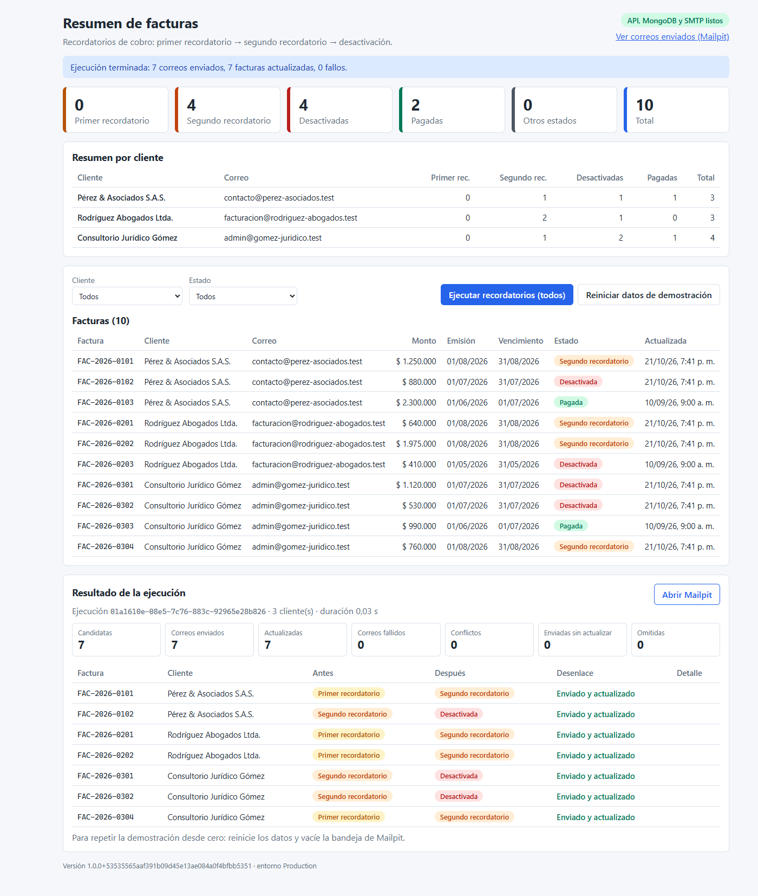

# invoice-reminders

**English** · [Español](README.es.md)

> The code targets **.NET 10** and the solution requires **Visual Studio 2026 (18.x)** for official support (VS 2022 17.14 with the .NET 10 SDK opens and builds it with a warning, but is not supported). Deploying with `docker compose` **does not depend on Visual Studio**.

A payment reminder process for invoices stored in MongoDB: for each invoice at the first or second reminder stage, it emails the customer and, only if the email was accepted, moves the invoice to the next stage (second reminder or deactivated).
It includes a Minimal API (.NET 10), a single-screen React UI with a summary of all invoices, and a `docker compose` setup with the app, MongoDB and a mail catcher (Mailpit).

[](https://github.com/JulianContreras02/invoice-reminders/actions/workflows/ci.yml)



More screenshots in the [verification guide](docs/VERIFICACION.md). The submission document is in [docs/ENTREGA.md](docs/ENTREGA.md) and also as a [PDF](docs/ENTREGA.pdf).

## Prerequisite

- **Docker Desktop** (with WSL2 on Windows). It is the only requirement to deploy and verify.
- You do **not** need to install .NET or Node: the frontend is built inside the image and the API is published in a Dockerfile stage.

## Quick start

```bash
git clone https://github.com/JulianContreras02/invoice-reminders.git
cd invoice-reminders
docker compose up --build
```

The first build takes 3 to 6 minutes; later builds take seconds. On startup, the app waits for MongoDB, creates the indexes and seeds the demo data (3 customers and 10 invoices) if the database is empty.

| Resource | URL |
|---|---|
| UI (invoice summary) | http://localhost:8080 |
| API documentation (Scalar) | http://localhost:8080/scalar (OpenAPI document at `/openapi/v1.json`) |
| Health | http://localhost:8080/health/ready (`/health/live` for liveness) |
| Captured emails (Mailpit) | http://localhost:8025 |
| MongoDB (optional, for Compass) | `mongodb://localhost:27017/invoice_reminders` |

All ports are published on `127.0.0.1` only.

## Running the reminder process

1. Open http://localhost:8080. You will see 10 invoices from 3 customers, the count cards per status and the per-customer summary.
2. Click **Ejecutar recordatorios (todos)** ("Run reminders (all)"), or **Ejecutar solo para {cliente}** ("Run only for {customer}") when a customer is selected in the filter. The result panel shows the counters, the `runId`, whether the run was interrupted (app shutdown) or stopped (MongoDB did not respond), and one row per invoice with its outcome.
3. Open http://localhost:8025 (or the **Ver correos enviados (Mailpit)** ("View sent emails") link in the header). With the initial data the sequence is deterministic:

| Run | Emails | What changes |
|---|---|---|
| 1st | 7 to 3 recipients: 4 second reminders ("ha pasado a segundo recordatorio") and 3 deactivation notices ("aviso de desactivación") | 4 invoices move to `segundorecordatorio`, 3 to `desactivado` |
| 2nd | 4 (deactivation) | the remaining 4 move to `desactivado` |
| 3rd | 0 | nothing: no eligible invoices are left |

Invoices in `pagada` (paid) or `desactivado` (deactivated) status never receive an email or change status.

From the command line:

```bash
curl -X POST http://localhost:8080/api/reminders/run                      # all customers
curl -X POST "http://localhost:8080/api/reminders/run?customerId=cli-002"   # a single customer
```

If a run or a reset is already in progress, the API returns `409` ("Operación en curso", operation in progress). If the `customerId` does not exist, it returns `404`.

## Resetting the data (and emptying Mailpit)

- The **Reiniciar datos de demostración** ("Reset demo data") button in the UI, or `POST http://localhost:8080/api/admin/seed/reset` (returns `403` if `Seed__AllowReset=false`).
- The reset restores MongoDB but does **not** empty Mailpit. To repeat the 7, 4 and 0 email sequence, empty the inbox with Mailpit's *Delete all* button or:

```bash
curl -X DELETE http://localhost:8025/api/v1/messages
```

- Full cleanup (containers and data volume):

```bash
docker compose down -v
```

## Environment variables

Defaults as set in `docker-compose.yml`. The `Section__Key` format maps to `Section:Key` in `appsettings*.json`.

| Variable | Value in compose | Notes |
|---|---|---|
| `Mongo__ConnectionString` | `mongodb://mongo:27017` | Required. Without it the app exits on startup with an error that names it. |
| `Mongo__Database` | `invoice_reminders` | Collections `clientes` and `facturas`. |
| `Smtp__Host` | `mailpit` | Required. |
| `Smtp__Port` | `1025` | 1-65535. Default in code: 1025. |
| `Smtp__Security` | `None` | `None`, `StartTls`, `SslOnConnect`, `Auto`. For a real SMTP server: `587` + `StartTls` or `465` + `SslOnConnect`. |
| `Smtp__FromAddress` | `recordatorios@invoice-reminders.test` | Required; must be a valid address. |
| `Smtp__FromName` | `Recordatorios de facturación` | |
| `Smtp__Username` / `Smtp__Password` | (empty) | Optional; set both or neither. Credentials are never committed. |
| `Smtp__TimeoutSeconds` | `10` | Same as the default in code. |
| `Seed__Mode` | `IfEmpty` | `IfEmpty`, `Always`, `Never`. Default in code: `Never` (seeding is opt-in). |
| `Seed__AllowReset` | `true` | Enables `POST /api/admin/seed/reset`. Default in code: `false`. |
| `Links__MailpitUrl` | `http://localhost:8025` | URL the UI shows for "Ver correos enviados". It reaches the frontend only through `GET /api/meta`. |

Host ports (`.env` file, optional; copy `.env.example` only if you need to change them):

| Variable | Default | Service |
|---|---|---|
| `APP_PORT` | `8080` | UI and API |
| `MAILPIT_PORT` | `8025` | Mailpit UI |
| `SMTP_PORT` | `1025` | Mailpit SMTP |
| `MONGO_PORT` | `27017` | MongoDB |

## Tests

The unit tests need neither Docker nor a network and run in under 3 seconds. They require the .NET 10 SDK (version pinned in `global.json`).

```bash
dotnet test                                   # from the root (InvoiceReminders.slnx)
dotnet test tests/InvoiceReminders.UnitTests  # the test project only
```

The `tests/InvoiceReminders.UnitTests` project uses `xunit.v3.mtp-off` 4.0.2, the official xunit.v3 variant that turns off Microsoft Testing Platform, with the classic `dotnet test` (VSTest, through `xunit.runner.visualstudio` and `Microsoft.NET.Test.Sdk`), so it also shows up in Visual Studio's Test Explorer. There are 48 test methods (62 cases counting each `[InlineData]` and each `[MemberData]` entry) covering the domain, the use case, the email composer, the seed, the dependency injection container, the mapping to MongoDB documents and the delivery failure rule in `MailKitEmailSender`, with hand-written test doubles in `tests/InvoiceReminders.UnitTests/Fakes`.

There are no integration tests against a real MongoDB or SMTP server and no frontend tests; the frontend is checked by `tsc` in strict mode at build time (`npm run build`). See [ADR 0008](docs/adr/0008-estrategia-de-pruebas.md).

## Continuous integration

`.github/workflows/ci.yml` runs on every push and pull request to `main` with three jobs: backend build and tests with warnings as errors, frontend build, and a smoke test that brings up this same `docker compose` and walks through the verification guide script (7, 4 and 0 emails). You can also run the smoke test locally with Docker, `curl` and `jq`:

```bash
docker compose up -d --build --wait
```

```bash
bash .github/scripts/compose-smoke.sh
```

## Opening and debugging in Visual Studio 2026

Open `InvoiceReminders.slnx` (the Visual Studio 2026 XML solution format; "ASP.NET and web development" workload).

**Local API with the infrastructure in Docker:**

1. Start only the infrastructure:
   ```bash
   docker compose up -d mongo mailpit
   ```
2. Startup project `InvoiceReminders.Api`, profile **http** (`http://localhost:5080`) or **https** (`https://localhost:7080`, which also listens on `http://localhost:5080`); both use the `Development` environment and open `/scalar`. `appsettings.Development.json` points to `localhost:27017` and `localhost:1025` with `Seed:Mode=IfEmpty` and `Seed:AllowReset=true`.
3. Press F5. Breakpoints in `ProcessRemindersUseCase` and Hot Reload work. If you skipped step 1, the `MongoStartupWaiter` log tells you so.
4. For the UI in development: `cd web && npm ci && npm run dev` (Node 22, ≥ 22.12). Vite (port 5173) proxies `/api` and `/health` to `http://localhost:5080`, so there is no CORS. With F5 the API does not serve the UI: `wwwroot/` is only generated inside the Docker image.

The repository does not include a Visual Studio Docker Compose orchestration project (`docker-compose.dcproj`); debugging the app inside containers with F5 is left as a possible next step.

Ready-to-run sample requests are in `src/InvoiceReminders.Api/InvoiceReminders.Api.http`.

## Repository structure

```
invoice-reminders/
├─ InvoiceReminders.slnx · global.json · Directory.Build.props · Directory.Packages.props
├─ docker-compose.yml · .env.example · nuget.config
├─ .github/         workflows/ci.yml · scripts/compose-smoke.sh (compose smoke test)
├─ docs/            ARQUITECTURA.md · DECISIONES.md · adr/0001…0010 · VERIFICACION.md · ENTREGA.md
├─ src/
│  ├─ InvoiceReminders.Domain/          Customer, Invoice, InvoiceStatus, ReminderPolicy
│  ├─ InvoiceReminders.Application/     ports, ProcessRemindersUseCase, ReminderEmailComposer, templates, DTOs
│  ├─ InvoiceReminders.Infrastructure/  Mongo (repositories, seed, indexes), MailKit, health checks, options
│  └─ InvoiceReminders.Api/             Program.cs, Endpoints/, Concurrency/, Errors/, Health/, Dockerfile
│                                       (wwwroot/ with the React build only exists inside the image)
├─ tests/
│  └─ InvoiceReminders.UnitTests/       xunit.v3 (xunit.v3.mtp-off), no Docker or network; hand-written doubles in Fakes/
└─ web/                                 React 19 + Vite 8 + TypeScript (npm run dev for development)
```

## Documentation

- [docs/ARQUITECTURA.md](docs/ARQUITECTURA.md): layers, diagrams (components, states, sequence), data model, email templates, dependency injection table.
- [docs/DECISIONES.md](docs/DECISIONES.md): index of the 10 ADRs in `docs/adr/`.
- [docs/VERIFICACION.md](docs/VERIFICACION.md): reviewer checklist with screenshots, including the scenario where SMTP is down.

## Troubleshooting

| Symptom | What to do |
|---|---|
| `port is already allocated` or `address already in use` on startup | Copy `.env.example` to `.env` and change `APP_PORT`, `MAILPIT_PORT`, `SMTP_PORT` or `MONGO_PORT`. |
| Docker Desktop out of memory or WSL2 slow (the build hangs, `mongo` never becomes healthy) | Give WSL2 at least 4 GB (`.wslconfig`), restart Docker Desktop and run `docker compose up --build` again. |
| Corporate proxy: `npm install` (or `npm ci`) or `dotnet restore` fails during the build | Configure the proxy in Docker Desktop (Settings > Resources > Proxies) and, if needed, your company's certificates. |
| The `app` container stops (`Exited`) | `docker compose logs app`: the last line names the cause (missing or invalid variable, MongoDB unreachable, seeding error). There is no `restart` policy, so the error is not hidden in a loop. |
| The UI does not reflect a change after updating the image | The browser cached the SPA: reload without cache (Ctrl+F5). |
| `mongo` restarts or dies immediately on an old x86 machine or a VM | MongoDB 5.0 and later require AVX on x86-64 (`mongo:7.0` included). There is no supported alternative tag: use another machine or enable AVX in the VM. ARM64/Apple Silicon is not affected. |
