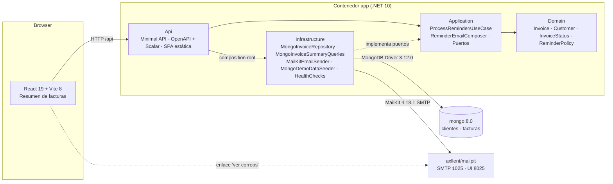
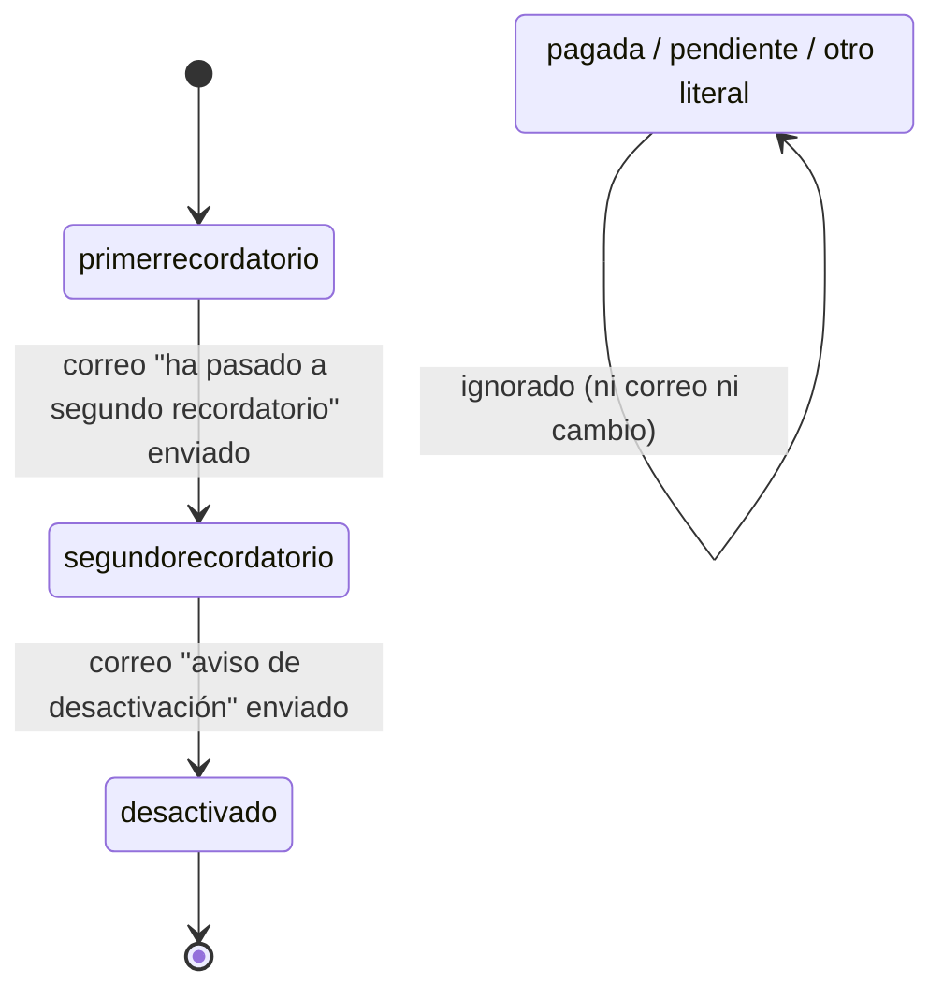
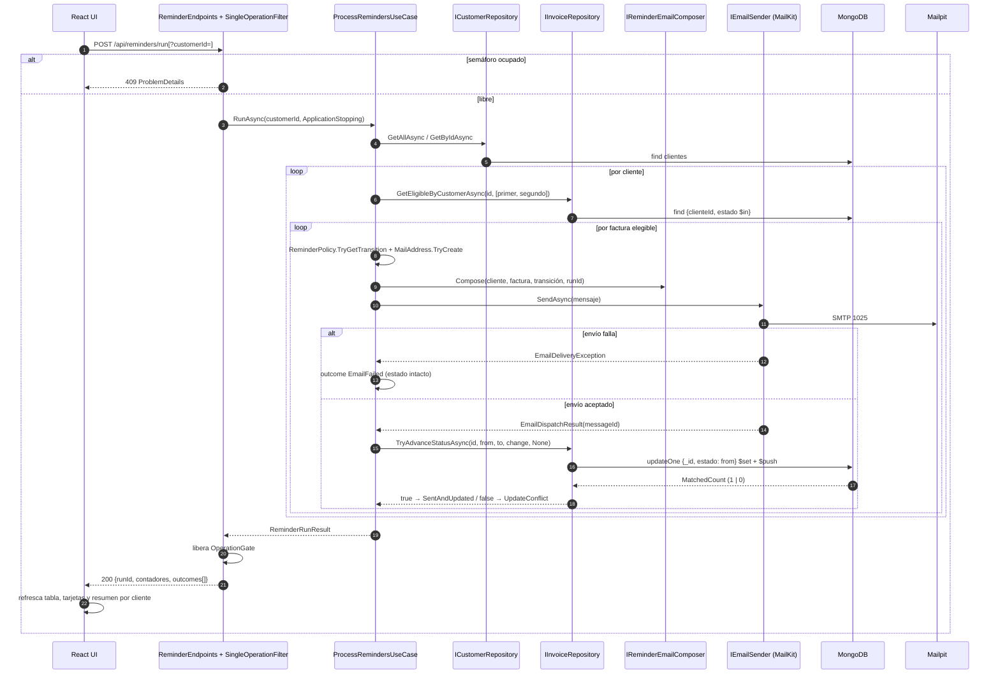

# Arquitectura — `invoice-reminders`

**Proyecto:** sistema de recordatorios de cobro sobre facturas en MongoDB (prueba técnica) · **Fecha:** 2026-10-21 · **Stack:** .NET 10 · React 19 + Vite 8 · MongoDB 8.0 · Mailpit

Este documento describe la arquitectura del sistema tal como se construye: capas, diagramas (componentes, estados, secuencia), modelo de datos, plantillas de correo, API y mapa de inyección de dependencias. Las decisiones que la sustentan están en [DECISIONES.md](DECISIONES.md) (índice de los ADR 0001 a 0010, sección 14). El README es el documento operativo; la guía paso a paso del equipo revisor es [VERIFICACION.md](VERIFICACION.md).

## 1. Propósito y alcance

El sistema es un proceso de cobranza escalonada (*dunning*) en .NET/C# conectado a una base MongoDB. Toma las facturas de un cliente, identifica las que están en primer o segundo recordatorio, envía al correo del cliente el mensaje correspondiente (aviso de que la factura pasa a segundo recordatorio, o aviso de que el servicio será desactivado) y, **solo después de que el envío fue aceptado**, avanza el estado de la factura al siguiente escalón (`segundorecordatorio` o `desactivado`). Funciona con tres clientes distintos y ofrece una interfaz React de una sola pantalla con el resumen de todas las facturas, conteos por estado y por cliente, y el botón que dispara el proceso.

La lectura del enunciado deja varios puntos abiertos; se resuelven con los supuestos siguientes, declarados aquí para que el equipo revisor los conozca antes de evaluar:

| Tema | Supuesto adoptado |
|---|---|
| Qué es "cliente" | La entidad deudora dueña de las facturas (un registro de la colección `clientes`, no una cuenta de la plataforma), con un correo de contacto único. "Tres clientes" = tres registros con sus facturas en una misma base. |
| Granularidad y transporte del correo | Un correo por factura (1 correo = 1 transición = 1 entrada de historial); SMTP real (MailKit) tras una interfaz, en la demo apuntando a un capturador local (Mailpit). Consolidar por cliente queda como mejora. |
| Disparo y alcance | Manual (endpoint + botón en la UI), nunca al arrancar, sin temporizador. Caso de uso parametrizado por cliente y orquestación para todos los clientes. Un paso por ejecución, sin ventanas de tiempo; botón "Reiniciar datos" para repetir la demo (vaciar Mailpit es un paso aparte). |
| Valores de estado y estados no contemplados | Literales exactos, minúsculas, sin espacios, comparación ordinal, centralizados en `InvoiceStatus`. Los estados distintos de los dos contemplados se ignoran (ni correo ni cambio) y se muestran en la UI; la semilla incluye `pagada` y `desactivado` para evidenciarlo. |
| Fallos | Si falla el correo, el estado no cambia, se registra y el lote continúa. Si el correo salió y la actualización falla, queda como inconsistencia visible y rastreable por `Message-ID`. |
| Cancelación | El lote no se cancela porque el navegador cierre la petición; corre con el token de apagado de la aplicación y se comprueba solo entre facturas. |
| "Desactivado" | Solo cambia el estado de la factura; el correo anuncia la desactivación del servicio como hecho futuro. No se marca al cliente. |
| Angular vs React | React: el criterio de evaluación admite las tres opciones; la justificación técnica está en el ADR 0006. |

**Origen de los datos:** las facturas son documentos en MongoDB sembrados por la propia aplicación con datos de prueba; no hay ingesta de archivos (PDF, imagen, Excel), ni OCR, ni servicios externos; el punto de extensión para una futura fuente de facturas es el puerto `IInvoiceRepository`. Lo que se deja fuera a propósito se resume en la sección 13.

## 2. Vista de contenedores

Monolito modular en .NET 10 con cuatro proyectos de producto (Domain, Application, Infrastructure, Api), un frontend React compilado dentro de la imagen de la API, y `docker compose` con **tres contenedores** que levantan con un comando.



| Contenedor | Imagen | Función | Puertos (solo loopback) |
|---|---|---|---|
| `app` | `invoice-reminders-app:local`, construida desde `src/InvoiceReminders.Api/Dockerfile` (multi-stage: `base` aspnet → `web` node → `build` sdk → `final FROM base`) | API Minimal + SPA React servida desde `wwwroot` + semilla al arrancar. Sin `restart`: si la configuración es inválida termina y `docker compose logs app` muestra la causa. | `127.0.0.1:8080` |
| `mongo` | `mongo:8.0` | Base `invoice_reminders` con `clientes` y `facturas`; volumen `mongo_data`; healthcheck con `mongosh` `ping`. | `127.0.0.1:27017` (opcional, para Compass) |
| `mailpit` | `axllent/mailpit:v1.31.6` | Capturador SMTP para la demo: recibe en 1025, muestra en 8025, API REST `/api/v1/messages`. Sin autenticación SMTP. | `127.0.0.1:8025`, `127.0.0.1:1025` |

`app` declara `depends_on` con `condition: service_healthy` para `mongo` (healthcheck con `mongosh`) y para `mailpit` (su imagen declara `HEALTHCHECK` con `/mailpit readyz`), así `/health/ready` arranca en verde. Los puertos se publican solo en `127.0.0.1` por higiene (Mongo y Mailpit sin autenticación no se exponen a la red local); `.env.example` permite cambiarlos (`APP_PORT`, `MAILPIT_PORT`, `SMTP_PORT`, `MONGO_PORT`). Imágenes base: `mcr.microsoft.com/dotnet/aspnet:10.0` (Ubuntu 24.04, no alpine: las variantes alpine activan `InvariantGlobalization` y rompen `es-CO`), `mcr.microsoft.com/dotnet/sdk:10.0` y `node:22-alpine`. Se usan tags de versión menor (`10.0`, `22-alpine`, `8.0`) para recibir parches de seguridad; Mailpit va fijado a `v1.31.6`.

## 3. Capas y regla de dependencias

Todas las flechas apuntan al dominio. La regla se hace cumplir con las referencias de los `.csproj` (revisables a simple vista) y se comprueba con un comando barato: `dotnet list src/InvoiceReminders.Application package --include-transitive` no debe contener `MongoDB`, `MailKit`, `MimeKit` ni `Microsoft.AspNetCore` (hoy es una verificación manual; no hay workflow de CI que la ejecute). No hay prueba por reflexión: `GetReferencedAssemblies()` solo ve ensamblados usados en IL y daría una falsa sensación de garantía.

| Proyecto | Referencia a | Paquetes permitidos | Contiene |
|---|---|---|---|
| Domain | nada | ninguno | `Customer`, `Invoice`, `InvoiceStatus`, `ReminderPolicy` (tabla de transiciones) |
| Application | Domain | `Microsoft.Extensions.Logging.Abstractions`, `Microsoft.Extensions.DependencyInjection.Abstractions` | puertos de negocio, caso de uso, DTOs de resumen, compositor de correos y plantillas, resultados |
| Infrastructure | Application | `MongoDB.Driver`, `MailKit`, `Microsoft.Extensions.Options.DataAnnotations`, `Microsoft.Extensions.Options.ConfigurationExtensions`, `Microsoft.Extensions.Diagnostics.HealthChecks` | repositorios Mongo, emisor MailKit, semilla (`DemoData`, `IDemoDataSeeder` + implementación), health checks, options, arranque (`InitializeInfrastructureAsync`) |
| Api | Application + Infrastructure | `Microsoft.AspNetCore.OpenApi`, `Scalar.AspNetCore` | composición, endpoints, exclusión de operaciones simultáneas (`OperationGate` + `SingleOperationFilter`), traducción de errores, writer JSON de salud, SPA |
| UnitTests | Domain + Application (+ Infrastructure solo para `DemoDataTests` y `DependencyInjectionTests`) | `xunit.v3.mtp-off` (variante oficial de xunit.v3 sin Microsoft Testing Platform), `xunit.runner.visualstudio`, `Microsoft.NET.Test.Sdk`, `Microsoft.Extensions.Configuration`, `Microsoft.Extensions.DependencyInjection` | pruebas y dobles escritos a mano en `Fakes/` |
| web | HTTP `/api` | | no conoce Mongo ni decide transiciones |

La referencia UnitTests → Infrastructure existe solo para `DemoDataTests` y `DependencyInjectionTests` (validan la semilla real y el grafo real); las pruebas del caso de uso no tocan ningún tipo de Infrastructure. `DemoData` vive en `Infrastructure/Seed` porque es quien lo siembra. No hay proyecto de pruebas de integración ni biblioteca compartida de dobles (ver sección 13.1).

Versiones (Central Package Management en `Directory.Packages.props`, una versión exacta por paquete): `MongoDB.Driver 3.12.0`, `MailKit 4.18.1`, `Scalar.AspNetCore 2.18.2`, `Microsoft.AspNetCore.OpenApi 10.0.13`, `Microsoft.Extensions.*` `10.0.13` (DependencyInjection.Abstractions, Logging.Abstractions, Options.DataAnnotations, Options.ConfigurationExtensions, Diagnostics.HealthChecks, Configuration y DependencyInjection), `xunit.v3.mtp-off 4.0.2`, `xunit.runner.visualstudio 4.0.1`, `Microsoft.NET.Test.Sdk 18.11.0`. SDK en `global.json`: `10.0.100` con `rollForward: latestFeature`.

### 3.1 Árbol de la solución

```
invoice-reminders/
├─ InvoiceReminders.slnx · global.json (SDK 10.0.100) · Directory.Build.props · Directory.Packages.props · .editorconfig
├─ docker-compose.yml · .env.example · .dockerignore · .gitignore · README.md
├─ docs/  ARQUITECTURA.md · DECISIONES.md · adr/0001…0010 · VERIFICACION.md · ENTREGA.md
├─ src/
│  ├─ InvoiceReminders.Domain/          Customers/Customer · Invoices/{Invoice, InvoiceStatus} · Reminders/{ReminderKind, ReminderTransition, ReminderPolicy}
│  ├─ InvoiceReminders.Application/     Ports/{IInvoiceRepository, IInvoiceSummaryQueries, ICustomerRepository, IEmailSender}
│  │                                    Reminders/{ProcessRemindersUseCase, ReminderRunResult, InvoiceOutcome, OutcomeKind, StatusChange}
│  │                                    Email/{IReminderEmailComposer, ReminderEmailComposer, IReminderEmailTemplate, ReminderEmailModel, RenderedEmail,
│  │                                           ReminderEmailLayout, SecondReminderTemplate, DeactivationNoticeTemplate, EmailMessage, EmailDispatchResult}
│  │                                    Invoices/{InvoiceSummaryDto, InvoiceRowDto, CustomerSummaryDto, InvoiceFilter}
│  │                                    Common/{EmailDeliveryException, CustomerNotFoundException} · DependencyInjection.cs (AddApplication)
│  ├─ InvoiceReminders.Infrastructure/  Options/{MongoOptions, SmtpOptions, SmtpSecurity, SeedOptions, LinksOptions}
│  │                                    Mongo/{MongoContext, Documents (CustomerDocument, InvoiceDocument, StatusChangeDocument), DocumentMappers,
│  │                                           MongoInvoiceRepository, MongoInvoiceSummaryQueries, MongoCustomerRepository, MongoIndexInitializer, MongoStartupWaiter}
│  │                                    Seed/{DemoData, IDemoDataSeeder, SeedMode, SeedResult, MongoDemoDataSeeder} · Email/MailKitEmailSender
│  │                                    Health/{HealthTags, MongoHealthCheck, SmtpTcpHealthCheck}
│  │                                    DependencyInjection.cs (AddInfrastructure + InitializeInfrastructureAsync: esperar Mongo → índices → semilla)
│  └─ InvoiceReminders.Api/             Program.cs (~60 líneas) · Endpoints/{Invoice, Reminder, Admin, Meta}Endpoints
│                                       Concurrency/{OperationGate, SingleOperationFilter} · Errors/ApiExceptionHandler · Health/HealthJsonResponseWriter · Dockerfile
│                                       InvoiceReminders.Api.http · appsettings*.json · Properties/launchSettings.json · wwwroot/ (build de React, solo dentro de la imagen; ignorado en git)
├─ tests/
│  └─ InvoiceReminders.UnitTests/       Domain/{ReminderPolicyTests, InvoiceStatusTests} · Application/{ProcessRemindersUseCaseTests, ReminderEmailComposerTests}
│                                       Composition/{DependencyInjectionTests, DemoDataTests}
│                                       Fakes/{InMemoryInvoiceRepository, InMemoryCustomerRepository, RecordingEmailSender, OperationJournal, FixedTimeProvider}
└─ web/                                 Vite + React + TypeScript (Node ≥ 22.12 en package.json) · src/{main.tsx, styles.css} · src/api/{client, types}
                                        features/invoices/{InvoicesPage, InvoiceTable, SummaryCards, CustomerSummary, InvoiceFilters, StatusBadge, statusLabels, format}
                                        features/reminders/RunResultPanel · features/health/HealthChip
```

## 4. Dominio y máquina de estados

El dominio no tiene dependencias ni atributos de persistencia. Entidades: `sealed record Customer(string Id, string Name, string Email)` y `sealed record Invoice(string Id, string CustomerId, decimal Amount, string Currency, DateOnly IssuedOn, DateOnly DueOn, InvoiceStatus Status, DateTimeOffset UpdatedAt)`; el número de factura **es** `Id`, no hay campo `Number` redundante.

`readonly record struct InvoiceStatus` (constructor privado, propiedad `Value`) envuelve el literal exacto de Mongo: estáticos `FirstReminder = new("primerrecordatorio")`, `SecondReminder = new("segundorecordatorio")`, `Deactivated = new("desactivado")`, `Paid = new("pagada")`, `Pending = new("pendiente")`; `From(string)` conserva cualquier literal desconocido sin normalizar; igualdad ordinal; `ToString()` devuelve el literal. Es el único lugar con las cadenas del contrato. `enum ReminderKind { SecondReminderNotice, DeactivationNotice }` y `sealed record ReminderTransition(InvoiceStatus From, InvoiceStatus To, ReminderKind Kind)` describen una transición. `static class ReminderPolicy` expone `IReadOnlyList<ReminderTransition> Transitions` con exactamente dos filas, `IReadOnlyCollection<InvoiceStatus> EligibleStatuses` y `bool TryGetTransition(InvoiceStatus current, out ReminderTransition t)`: es la máquina de estados completa, cubierta por dos `[Theory]` en `ReminderPolicyTests` (transiciones válidas y estados fuera del proceso).

El diagrama siguiente es la misma tabla que `ReminderPolicy.Transitions`:



**Cómo se añade una transición:** una fila más en `ReminderPolicy.Transitions`, un valor más en `ReminderKind` y una implementación nueva de `IReminderEmailTemplate` registrada en la colección (`TryAddEnumerable`). El caso de uso, los repositorios y los endpoints no cambian.

## 5. Caso de uso de recordatorios

`ProcessRemindersUseCase(ICustomerRepository, IInvoiceRepository, IReminderEmailComposer, IEmailSender, TimeProvider, ILogger<ProcessRemindersUseCase>)` expone `Task<ReminderRunResult> RunAsync(string? customerId, ct)`. Es la única clase que conoce el orden **componer → enviar → actualizar**. Disparo: `POST /api/reminders/run` para todos los clientes o `POST /api/reminders/run?customerId=cli-002` para uno (parámetro de query string, sin cuerpo).

1. `SingleOperationFilter` intenta entrar en `OperationGate` (semáforo singleton); si está ocupado responde 409 ProblemDetails con título "Operación en curso".
2. El endpoint llama a `RunAsync(customerId, lifetime.ApplicationStopping)`. `runId = Guid.CreateVersion7()`, `startedAt = TimeProvider.GetUtcNow()`, `logger.BeginScope({RunId})`. Carga clientes (todos, ordenados por Id, o el indicado; inexistente → `CustomerNotFoundException` → 404).
3. Por cliente, secuencialmente, `GetEligibleByCustomerAsync(customerId, ReminderPolicy.EligibleStatuses)` → filtro Mongo `{ clienteId, estado: { $in: ["primerrecordatorio", "segundorecordatorio"] } }` ordenado por `_id`. Los demás estados nunca entran en memoria.
4. Por factura (las capturas de excepción se limitan al envío y a la actualización):
   a. `ReminderPolicy.TryGetTransition(invoice.Status)`; si falla → `SkippedNotEligible` (defensa en profundidad).
   b. Valida el correo del cliente con `MailAddress.TryCreate`; si es inválido → `SkippedNoEmail` (sin envío ni cambio, log Warning).
   c. `composer.Compose(customer, invoice, transition, runId)`.
   d. **Envío:** `await emailSender.SendAsync(message, ct)`. Si lanza `EmailDeliveryException` → `EmailFailed`, log Warning con `{InvoiceId}{CustomerId}`, estado intacto, continúa.
   e. **Actualización (solo tras envío aceptado):** `TryAdvanceStatusAsync(invoice.Id, from, to, change, CancellationToken.None)`; el CAS nunca se cancela una vez que el correo salió. `true` → `SentAndUpdated(messageId)`; `false` → `UpdateConflict` (otro actor movió la factura entre lectura y escritura; log Warning); excepción → `UpdateFailedAfterSend` (log Error con `MessageId`).
5. La cancelación (`ct` = apagado de la aplicación) se comprueba **entre** facturas, nunca entre d y e; si se solicita, el resultado sale con `Cancelled = true` y lo procesado hasta entonces. Un `OperationCanceledException` dentro de d que no venga del token de quien llama (timeout del propio `SmtpClient`) se traduce en `MailKitEmailSender` a `EmailDeliveryException`, así que nunca se confunde cancelación del lote con fallo de correo.
6. Devuelve 200 con `ReminderRunResult` aunque haya fallos parciales (`HasFailures` lo señala; la UI lo resalta); 4xx/5xx solo si el proceso no pudo iniciarse. Log Information: "Recordatorios {RunId}: {Candidates} candidatas, {Sent} enviados, {Updated} actualizadas, {Failed} fallidas, {Skipped} omitidas en {Duration}".



**Desenlaces por factura.** `enum OutcomeKind { SentAndUpdated, EmailFailed, UpdateConflict, UpdateFailedAfterSend, SkippedNoEmail, SkippedNotEligible }`: `SentAndUpdated` (correo enviado y estado avanzado; `MessageId` presente), `EmailFailed` (SMTP rechazó o no respondió; estado intacto), `UpdateConflict` (correo enviado, el CAS devolvió `false` porque otro actor movió la factura; aviso, no fallo), `UpdateFailedAfterSend` (correo enviado, el CAS lanzó; `MessageId` rastreable), `SkippedNoEmail` (cliente sin email válido), `SkippedNotEligible` (sin transición para el estado; defensa en profundidad). Cada factura procesada produce un `InvoiceOutcome(string InvoiceId, string CustomerId, string CustomerName, string CustomerEmail, string PreviousStatus, string? NewStatus, OutcomeKind Kind, string? MessageId, string? Error)`. La cancelación entre facturas no es un desenlace: se refleja en `Cancelled = true` y las facturas no procesadas simplemente no aparecen en `Outcomes`.

**Invariantes del resultado.** `ReminderRunResult(Guid RunId, DateTimeOffset StartedAt, TimeSpan Duration, string? CustomerId, int CustomersProcessed, bool Cancelled, IReadOnlyList<InvoiceOutcome> Outcomes)`; los contadores son propiedades calculadas a partir de `Outcomes` (`Candidates`, `Updated`, `UpdateConflicts`, `UpdateFailedAfterSend`, `EmailFailed`, `EmailsSent`, `Skipped`, `Failed`, `HasFailures`), así que las invariantes se cumplen por construcción y están probadas en `ProcessRemindersUseCaseTests`: `Candidates = EmailsSent + EmailFailed + Skipped`; `EmailsSent = Updated + UpdateConflicts + UpdateFailedAfterSend`; `Updated` = número de desenlaces `SentAndUpdated`; `Skipped` = `SkippedNoEmail` + `SkippedNotEligible`; `Failed = EmailFailed + UpdateFailedAfterSend`; `HasFailures = Failed > 0`. `UpdateConflicts` se cuenta aparte y se muestra como aviso, no como fallo.

## 6. Errores, idempotencia y concurrencia

**Arranque (falla rápido y autoexplicativo).** `Program.cs` llama a la extensión `InitializeInfrastructureAsync` (`Infrastructure/DependencyInjection.cs`) antes de abrir el puerto: esperar MongoDB → crear índices → sembrar según `Seed__Mode`. Cualquier excepción en ese paso se registra con `LogCritical` ("La aplicación no pudo iniciar: {Reason}") y el proceso termina con código 1; el contenedor se queda parado (sin `restart`) para que `docker compose logs app` muestre la causa. Opciones inválidas → `OptionsValidationException` (las opciones usan `ValidateDataAnnotations()` y `ValidateOnStart()`); el mensaje nombra la variable de entorno (`Mongo__ConnectionString`, `Smtp__Host`…). Mongo no disponible → `MongoStartupWaiter` reintenta 15 veces, con 2 s entre intentos, con el log "Esperando MongoDB (intento {i}/15): {motivo}" y termina con "No fue posible conectar con MongoDB. Revise Mongo__ConnectionString o, si ejecuta la API fuera de Docker, levante las dependencias con: docker compose up -d mongo mailpit". Error al sembrar → aborta el arranque. En Development, `WebApplication.CreateBuilder` activa por defecto `ValidateOnBuild` y `ValidateScopes`, que detectan registros faltantes y dependencias cautivas en el primer F5.

**Petición.** ProblemDetails (RFC 9457) con `traceId` vía `ApiExceptionHandler` (`CustomerNotFoundException` → 404; resto → 500). Sin `catch` vacíos; toda captura registra con contexto estructurado.

**Proceso.** Fallos aislados por factura; el lote nunca aborta; seis desenlaces distinguibles y coloreados en la UI. SMTP caído → `/health/ready` reporta `smtp` como `Degraded`, la UI muestra el aviso, las candidatas quedan `EmailFailed` y, al levantar Mailpit, la siguiente ejecución las procesa (demostración del CA-08).

**Idempotencia.** Unidad de trabajo = (factura, transición). El filtro `{_id, estado: estadoAnterior}` es la **única** vía de cambio de estado: no existe un `UpdateStatus(id, nuevo)` incondicional en la interfaz. Una factura avanza exactamente un paso por ejecución; la tercera ejecución sobre la semilla es un no-op. Semilla idempotente (`IfEmpty`) y determinista (`Always`); índices con `CreateOneAsync` idempotente; el mapeo BSON se declara con atributos en las clases `*Document`, sin class maps. Los correos no son idempotentes: el único duplicado posible es `UpdateConflict`/`UpdateFailedAfterSend` (correo salió, estado no avanzó) o el caso "el proceso muere entre envío y actualización"; en ambos la factura sigue en el estado anterior, la siguiente ejecución la reprocesa y envía un segundo correo con el mismo prefijo de `Message-ID` (`{numeroFactura}.{estadoAnterior}.…`) y otro `runId`, visible en Mailpit. No hay outbox: exigiría otra colección y un reconciliador y no eliminaría el duplicado (SMTP no es transaccional); se declara como evolución en el ADR 0004.

**Concurrencia.** Una instancia: `OperationGate` (singleton con un `SemaphoreSlim(1,1)`, en `Api/Concurrency`) y `SingleOperationFilter` (`IEndpointFilter` que hace `TryEnter` sin espera) serializan `run` y `reset` → 409; la UI deshabilita los botones mientras corre. Varias instancias (fuera de alcance): el CAS garantiza que ninguna factura avance dos veces; podría duplicarse un correo; solución futura: lease en Mongo con TTL. `IMongoClient` singleton thread-safe; `SmtpClient` de MailKit nuevo por envío (no es thread-safe). Sin transacciones multi-documento: cada unidad es un documento (`$set` + `$push` atómicos) y exigirían replica set en compose.

## 7. Modelo de datos y semilla

Base `invoice_reminders`, colecciones `clientes` y `facturas`. Campos en español porque `estado` es el contrato visible; código en inglés con la frontera de traducción en `DocumentMappers` (`InvoiceDocument`, `CustomerDocument`, `StatusChangeDocument` son `internal` con `[BsonElement]`; el dominio no lleva atributos Bson). `_id` de negocio en texto: el `_id` de la factura **es** su número (`FAC-2026-0102`); no hay campo `numero` ni índice único sobre él. Fechas UTC; `monto` como `Decimal128`; `ejecucionId` se persiste como string (`runId.ToString("D")`). Sin autenticación en la demo (solo demo local; puertos en loopback).

```json
// clientes
{
  "_id": "cli-001",
  "nombre": "Pérez & Asociados S.A.S.",
  "email": "contacto@perez-asociados.test",
  "creadoEn": { "$date": "2026-01-15T00:00:00Z" }
}

// facturas
{
  "_id": "FAC-2026-0102",
  "clienteId": "cli-001",
  "monto": { "$numberDecimal": "880000" },
  "moneda": "COP",
  "fechaEmision": { "$date": "2026-07-01T00:00:00Z" },
  "fechaVencimiento": { "$date": "2026-07-31T00:00:00Z" },
  "estado": "segundorecordatorio",
  "historialEstados": [],
  "actualizadoEn": { "$date": "2026-09-10T14:00:00Z" }
}
```

La semilla inserta las facturas con `historialEstados` vacío. Tras una ejecución, el CAS (`UpdateOneAsync` con filtro `{_id, estado: expected}` y `Update.Set(estado, next).Set(actualizadoEn, at).Push(historialEstados, …)`; éxito si `MatchedCount == 1`) añade `{ "de": "segundorecordatorio", "a": "desactivado", "fecha": …, "motivo": "recordatorio", "ejecucionId": "019a…", "mensajeId": "FAC-2026-0102.segundorecordatorio.019a…@invoice-reminders.test" }` (el `mensajeId` se guarda sin corchetes angulares; el `runId` va sin guiones).

**Índices** (`MongoIndexInitializer`, idempotente con `CreateOneAsync`; declarativos, no de rendimiento: hay 10 documentos): `facturas { clienteId: 1, estado: 1 }` (`ix_clienteId_estado`) y `clientes { email: 1 } unique` (`ux_email`).

**Semilla** (`MongoDemoDataSeeder` sobre `DemoData`; modos `SeedMode { Never, IfEmpty, Always }`; `IfEmpty` en compose y Development, `Never` por defecto). Dominio `.test` reservado para no enviar jamás a direcciones reales:

| Cliente | Email | Facturas (número → estado, COP) |
|---|---|---|
| cli-001 Pérez & Asociados S.A.S. | contacto@perez-asociados.test | 0101 primerrecordatorio 1.250.000 · 0102 segundorecordatorio 880.000 · 0103 pagada 2.300.000 |
| cli-002 Rodríguez Abogados Ltda. | facturacion@rodriguez-abogados.test | 0201 primerrecordatorio 640.000 · 0202 primerrecordatorio 1.975.000 · 0203 desactivado 410.000 |
| cli-003 Consultorio Jurídico Gómez | admin@gomez-juridico.test | 0301 segundorecordatorio 1.120.000 · 0302 segundorecordatorio 530.000 · 0303 pagada 990.000 · 0304 primerrecordatorio 760.000 |

El nombre `Pérez & Asociados S.A.S.` está a propósito: ejercita el `HtmlEncode` del cuerpo y el `MailboxAddress` con nombre y dirección separados. `DemoDataTests` fija lo que la semilla cumple: 3 clientes con emails distintos; 10 facturas con ids únicos y dueño conocido; los totales iniciales 4/3/1/2 (primer/segundo/desactivado/pagada); cada cliente con ≥ 1 factura elegible; y, ejecutando el caso de uso real sobre los dobles en memoria, 7 → 4 → 0 correos en tres ejecuciones, 3 destinatarios distintos y 8 facturas desactivadas al final.

**Historia determinista del revisor** (la misma que afirma `DemoDataTests`):

| Momento | primer | segundo | desactivado | pagada | Correos |
|---|---|---|---|---|---|
| Inicial | 4 | 3 | 1 | 2 | — |
| Ejecución 1 | 0 | 4 | 4 | 2 | 7 (4 "segundo recordatorio" + 3 "desactivación"), 3 destinatarios |
| Ejecución 2 | 0 | 0 | 8 | 2 | 4 (desactivación) |
| Ejecución 3 | 0 | 0 | 8 | 2 | 0 |

"Reiniciar datos" (`POST /api/admin/seed/reset`, modo `Always`: borra e inserta los mismos `_id`) restaura Mongo pero **no** vacía Mailpit; ese paso se documenta aparte (botón *Delete all* o `DELETE http://localhost:8025/api/v1/messages`) y el `RunResultPanel` lo recuerda. No se acopla el reinicio a la API de Mailpit.

## 8. Correo y plantillas

**Transporte:** `MailKitEmailSender` (MailKit 4.18.1). Por envío crea un `MailKit.Net.Smtp.SmtpClient`, `ConnectAsync(host, port, ToSecureSocketOptions(Security))`, autentica solo si hay usuario, construye el `MimeMessage` con `new MailboxAddress(message.ToName, message.ToAddress)` y `MailboxAddress(FromName, FromAddress)`, `SendAsync`, `DisconnectAsync(true)`. Traduce `SocketException`, `IOException`, `TimeoutException`, `SmtpCommandException`, `SmtpProtocolException`, `AuthenticationException`, `SslHandshakeException`, `ServiceNotConnectedException`, `ServiceNotAuthenticatedException`, `ParseException` y el `OperationCanceledException` que no pidió quien llama (timeout) a `EmailDeliveryException("No se pudo entregar el correo a {to} vía {host}:{port}: {detalle}")`; una cancelación pedida por quien llama se deja propagar. Es Singleton porque crea y desecha su propio `SmtpClient` en cada envío. Configuración por `SmtpOptions { Host, Port = 1025, FromAddress, FromName, Security = SmtpSecurity.None, Username?, Password?, TimeoutSeconds = 10 }` con `enum SmtpSecurity { None, StartTls, SslOnConnect, Auto }`; para un SMTP real solo cambian variables (`Smtp__Host`, `Smtp__Port=587` + `Smtp__Security=StartTls`, o `Smtp__Port=465` + `Smtp__Security=SslOnConnect`, `Smtp__Username`, `Smtp__Password`). No existe un emisor simulado (`LoggingEmailSender`): devolver éxito sin enviar permitiría avanzar estados sin correo; Mailpit es el camino para depurar.

**Composición** (`ReminderEmailComposer`, en Application, pura, probada por unidad): un correo por factura, multipart texto + HTML sencillo sin imágenes; remitente `Recordatorios de facturación <recordatorios@invoice-reminders.test>`; destinatario con nombre y dirección por separado en `EmailMessage(ToName, ToAddress, Subject, TextBody, HtmlBody, MessageId, Headers)`; monto formateado con `CultureInfo("es-CO")` y fecha `dd/MM/yyyy`; el monto usa el formato `N0` sin símbolo y la moneda se añade como texto (p. ej. `1.250.000 COP`). Cada plantilla interpola `ReminderEmailModel(CustomerName, InvoiceNumber, AmountFormatted, Currency, DueOnFormatted)` en un asunto y una lista de párrafos, y `ReminderEmailLayout` arma con ellos el texto plano y el HTML (`<h2>` con el asunto y un `<p>` por párrafo), codificando todo con `WebUtility.HtmlEncode` antes de insertarlo (sin motor de plantillas). La plantilla se selecciona por `ReminderKind` entre las `IReminderEmailTemplate` registradas (`Kind`; `Render(model)` → `RenderedEmail(Subject, TextBody, HtmlBody)`); el constructor del compositor falla si falta la plantilla de algún `ReminderKind`.

**Plantilla A — `SecondReminderTemplate` (`SecondReminderNotice`, factura encontrada en `primerrecordatorio`):**
- Asunto: `Factura {numero}: ha pasado a segundo recordatorio`
- Cuerpo (cuatro párrafos): "Estimado(a) {nombreCliente}:" · "Le informamos que la factura {numero} por {monto} {moneda}, con fecha de vencimiento {fechaVencimiento}, no registra pago y ha pasado a segundo recordatorio." · "Le invitamos a regularizar el pago a la mayor brevedad para evitar la desactivación del servicio." · "Si ya realizó el pago, por favor ignore este mensaje. Este es un mensaje automático; no responda a este correo."

**Plantilla B — `DeactivationNoticeTemplate` (`DeactivationNotice`, factura encontrada en `segundorecordatorio`):**
- Asunto: `Factura {numero}: aviso de desactivación del servicio`
- Cuerpo (cuatro párrafos): "Estimado(a) {nombreCliente}:" · "La factura {numero} por {monto} {moneda}, vencida el {fechaVencimiento}, se encontraba en segundo recordatorio y continúa sin pago, por lo que el servicio asociado va a ser desactivado." · "Para evitarlo, realice el pago y comuníquese con nosotros." · "Si ya realizó el pago, por favor ignore este mensaje. Este es un mensaje automático; no responda a este correo."

**Trazabilidad:** cabeceras `X-Invoice-Id`, `X-Reminder-Kind`, `X-Reminder-Run-Id` (`runId` con guiones) y `Message-ID` determinista `{numeroFactura}.{estadoAnterior}.{runId sin guiones}@invoice-reminders.test`, guardado sin corchetes angulares (MimeKit los añade al escribir la cabecera). El mismo `Message-ID` se guarda en `historialEstados[].mensajeId` y se devuelve en `InvoiceOutcome.MessageId`, de modo que un correo en Mailpit, una entrada de historial en Mongo y una fila del resultado se cruzan sin ambigüedad.

## 9. API

Prefijo `/api`, JSON camelCase (enums como texto con `JsonStringEnumConverter`), errores `application/problem+json`, documento OpenAPI en `/openapi/v1.json` (`MapOpenApi`) y documentación interactiva en `/scalar` (`Scalar.AspNetCore`, `MapScalarApiReference`), siempre habilitadas. Sin CORS (proxy de Vite en desarrollo; mismo origen en compose). Los endpoints consumen `IInvoiceSummaryQueries` directamente; no hay clase intermedia sin lógica. `InvoiceReminders.Api.http` trae las llamadas listas para Visual Studio.

| Método y ruta | Respuesta |
|---|---|
| `GET /api/invoices?customerId=&status=` | `InvoiceSummaryDto { invoices[], countsByStatus{}, customers[] (id, name, email, countsByStatus, total), total }`; los filtros solo afectan a `invoices[]`, los conteos cubren todas las facturas. El resumen por cliente sale de `customers[]` |
| `POST /api/reminders/run[?customerId=]` | 200 `ReminderRunResult` · 404 cliente inexistente · 409 operación en curso |
| `POST /api/admin/seed/reset` | 200 `SeedResult` · 403 si `Seed:AllowReset=false` · 409 en curso |
| `GET /api/meta` | `{ version, environment, mailpitUrl, allowReset, smtpHost, smtpPort, mongoDatabase }` (sin secretos) |
| `GET /health/live` · `GET /health/ready` | 200 (sin checks, texto plano) · 200/503 con JSON `{ status, checks: [{ name: "mongo" \| "smtp", status, description }] }` (`HealthJsonResponseWriter`, en `Api/Health`) |
| `GET /openapi/v1.json` · `GET /scalar` | Documento OpenAPI · documentación interactiva |
| Cualquier otra ruta bajo `/api` | 404 (`MapFallback("/api/{**path}")`), nunca la página de React |
| `GET /` y rutas no-API | `index.html` de React (`MapFallbackToFile`) |

No existen `GET /api/customers` ni `GET /api/invoices/{id}`; un detalle de factura con su historial queda como evolución (sección 13.1).

`POST /api/reminders/run` y `POST /api/admin/seed/reset` llevan `SingleOperationFilter` (`AddEndpointFilter<SingleOperationFilter>()`). `ReminderEndpoints` pasa al caso de uso `IHostApplicationLifetime.ApplicationStopping` como token, no `HttpContext.RequestAborted`. La URL de Mailpit llega a la UI **solo** por `/api/meta` (`LinksOptions.MailpitUrl`); ninguna variable `VITE_*`.

## 10. Frontend

`web/`: Vite 8.3.5, React 19.3.1, `@vitejs/plugin-react` 6.1.2, TypeScript 5.9.3 en modo estricto (`strict`, `noUnusedLocals`, `noUnusedParameters`, `noUncheckedIndexedAccess`); Node ≥ 22.12 declarado en `engines` de `package.json` y `node:22-alpine` en el Dockerfile. Scripts: `dev` (`vite`), `build` (`tsc && vite build`), `typecheck` (`tsc`), `preview`. Sin router, sin gestor de estado global, sin librería de componentes: CSS plano con variables, tabla semántica, botones con texto, foco visible. No hay ESLint ni pruebas de componentes (Vitest no está instalado); la verificación del frontend es la compilación estricta de `tsc`. El frontend no conoce Mongo ni decide transiciones: todos los conteos vienen del endpoint.

Pantalla única "Resumen de facturas" (`features/invoices/InvoicesPage`):

1. **Encabezado:** título, chip de salud (`features/health/HealthChip`) desde `/health/ready` ("API, MongoDB y SMTP listos" / "SMTP no disponible" / "MongoDB no disponible", distinguidos por el JSON por check), enlace "Ver correos enviados (Mailpit)" desde `/api/meta`.
2. **`SummaryCards`** (Primer recordatorio, Segundo recordatorio, Desactivadas, Pagadas, Otros estados, Total) y **`CustomerSummary`**: tabla compacta con los tres clientes (nombre, correo, facturas en primer/segundo recordatorio, desactivadas, pagadas y total, de `customers[]`). Evidencia visual directa de "tres clientes" (CA-11/CA-12).
3. **`InvoiceFilters`** (select de cliente: Todos + los 3; select de estado con los cuatro estados conocidos) y **acciones**: "Ejecutar recordatorios (todos)", "Ejecutar solo para {cliente}" (si hay filtro de cliente), "Reiniciar datos de demostración" (solo si `allowReset`; con confirmación, el diálogo recuerda vaciar Mailpit). Deshabilitados mientras hay operación; 409 se muestra como aviso.
4. **`InvoiceTable`:** Factura (`id`), Cliente, Correo, Monto (`Intl.NumberFormat('es-CO', {style:'currency', currency, maximumFractionDigits: 0})`), Emisión, Vencimiento, Estado (`StatusBadge` con etiqueta legible desde `statusLabels.ts`; desconocidos tal cual en gris), Actualizada.
5. **`RunResultPanel`** (`features/reminders`): contadores (candidatas, correos enviados, actualizadas, correos fallidos, conflictos, enviadas sin actualizar, omitidas), duración, `runId`, tabla por factura (antes → después, desenlace coloreado, detalle del error), botón "Abrir Mailpit" y nota para vaciar Mailpit antes de repetir la demo; tras cada operación se refrescan tabla, tarjetas y resumen por cliente. Estados de carga, vacío y error de red con reintento.

**Integración.** `src/api/client.ts` usa rutas relativas (`/api`, `/health`) y parsea ProblemDetails. En desarrollo, `vite.config.ts` (puerto 5173) hace proxy de `/api` y `/health` a `http://localhost:5080` (perfil `http` de la API), por lo que no hace falta CORS; el camino de desarrollo del front es `npm run dev`. En compose, la etapa `web` del Dockerfile ejecuta `npm ci` con el `package-lock.json` versionado (que incluye los binarios de Linux musl que usa la imagen) y `npm run build`, y la etapa `final` copia `dist/` a `wwwroot`, servido por `UseDefaultFiles/UseStaticFiles/MapFallbackToFile("index.html")` en el mismo origen (las rutas `/api` inexistentes responden 404 antes de llegar a ese fallback): el revisor nunca ejecuta npm ni necesita Node. No hay target MSBuild que ejecute npm en el build de Visual Studio.

## 11. Inyección de dependencias

Contenedor nativo `Microsoft.Extensions.DependencyInjection`; solo inyección por constructor; sin Service Locator ni estáticos con estado. `ValidateOnBuild` y `ValidateScopes` quedan activos en Development por el comportamiento por defecto de `WebApplication.CreateBuilder`. Dos puntos de registro: `AddApplication()` (`Application/DependencyInjection.cs`) y `AddInfrastructure(IConfiguration)` (`Infrastructure/DependencyInjection.cs`), más `OperationGate` y los servicios HTTP en `Program.cs`, que queda en ~60 líneas.

**Criterio de lifetimes:** **Singleton** para todo lo que no tiene estado por petición y cuyas dependencias son singleton (cliente Mongo, colecciones, plantillas, compositor, emisor que crea su propio `SmtpClient` por llamada); **Scoped** solo para las clases que participan en una petición y se benefician de compartir el mismo scope de `ILogger` / `IOptionsSnapshot` o de ser recreadas por request (caso de uso y repositorios); **Transient** para lo que se usa una vez en arranque o en un endpoint administrativo.

| Abstracción | Implementación | Lifetime | Razón |
|---|---|---|---|
| `TimeProvider` | `TimeProvider.System` | Singleton (`TryAdd`) | Reloj abstraído; las pruebas usan `FixedTimeProvider` (doble propio) |
| `IReminderEmailTemplate` (×2) | `SecondReminderTemplate`, `DeactivationNoticeTemplate` | Singleton (`TryAddEnumerable`) | Puras, sin estado; colección extensible |
| `IReminderEmailComposer` | `ReminderEmailComposer` | Singleton | Pura; depende solo de la colección de plantillas (singleton) |
| `ProcessRemindersUseCase` | — | Scoped | Una por petición; depende de repositorios scoped; su scope de `ILogger` (`RunId`) vive lo que la petición |
| `IOptions<MongoOptions>` / `SmtpOptions` / `SeedOptions` / `LinksOptions` | `AddOptions<T>().Bind(configuration.GetSection("Mongo"/"Smtp"/"Seed"/"Links")).ValidateDataAnnotations().ValidateOnStart()` | Singleton | Falla al arrancar nombrando la variable de entorno |
| `IMongoClient` | `new MongoClient(MongoClientSettings.FromConnectionString(cs))` con `ApplicationName = "invoice-reminders"` y `ServerSelectionTimeout` de 5 s | Singleton | Thread-safe con pool interno; uno transitorio crearía un pool por petición |
| `MongoContext` | — | Singleton | Expone `Database` (`client.GetDatabase(options.Database)`) y las colecciones tipadas; `IMongoDatabase` e `IMongoCollection<T>` son thread-safe |
| `IInvoiceRepository` | `MongoInvoiceRepository` | Scoped | Sin estado propio; Scoped (y no Singleton) para que forme parte del grafo de la petición junto al caso de uso y para que `ValidateScopes` detecte cualquier futura dependencia por request (p. ej. un `IOptionsSnapshot`). Podría ser Singleton sin cambiar comportamiento |
| `IInvoiceSummaryQueries` | `MongoInvoiceSummaryQueries` | Scoped | Ídem |
| `ICustomerRepository` | `MongoCustomerRepository` | Scoped | Ídem |
| `IEmailSender` | `MailKitEmailSender` | Singleton | Sin estado: crea y desecha un `SmtpClient` de MailKit por envío (ese cliente no es thread-safe, pero nunca se comparte); depende solo de `IOptions<SmtpOptions>` e `ILogger` (singletons) |
| `IDemoDataSeeder` | `MongoDemoDataSeeder` | Transient | Se usa al arrancar y en el endpoint de reinicio |
| `OperationGate` | — | Singleton (en `Program.cs`) | Debe ser único por proceso (un `SemaphoreSlim(1,1)`); `SingleOperationFilter` no se registra: lo instancia `AddEndpointFilter<T>()` y recibe el `OperationGate` por constructor |
| `MongoIndexInitializer`, `MongoStartupWaiter` | — | Transient | Invocados por `InitializeInfrastructureAsync` dentro de un scope creado con `CreateAsyncScope()`, antes de abrir el puerto |
| `IHealthCheck` | `MongoHealthCheck` (`Unhealthy`, tag `HealthTags.Ready`), `SmtpTcpHealthCheck` (`Degraded`, tag `HealthTags.Ready`) | Según `AddHealthChecks` | `/health/live` sin checks; `/health/ready` filtra por tag y responde con `HealthJsonResponseWriter` (Api) |
| Api | `AddProblemDetails`, `AddExceptionHandler<ApiExceptionHandler>`, `AddOpenApi`, `ConfigureHttpJsonOptions` (`JsonStringEnumConverter`) | — | Infraestructura HTTP (sin CORS) |

Reglas comprobadas: ningún Singleton recibe un Scoped (sin dependencias cautivas; `ValidateOnBuild` lo verifica en Development y en `DependencyInjectionTests`); ningún servicio recibe `IConfiguration` ni `IServiceProvider` (solo `AddInfrastructure` lee configuración); las pruebas construyen `ProcessRemindersUseCase` por constructor con dobles escritos a mano (`InMemoryCustomerRepository`, `InMemoryInvoiceRepository`, `RecordingEmailSender`, `FixedTimeProvider`) y `DependencyInjectionTests` valida el grafo completo con configuración en memoria.

## 12. Mapa de evaluación

Criterio de evaluación → evidencia en el repositorio:

| Criterio | Evidencia concreta |
|---|---|
| Clean Code y SOLID | `src/InvoiceReminders.Domain/Reminders/ReminderPolicy.cs` (tabla única de transiciones); `InvoiceStatus.cs` (cero cadenas mágicas fuera); `Application/Reminders/ProcessRemindersUseCase.cs` (solo orquesta; < 140 líneas; 6 dependencias); puertos de 1-2 métodos en `Application/Ports/`; referencias de `.csproj` con flechas hacia Domain; `Directory.Build.props` con analizadores (`AnalysisLevel latest`, `EnforceCodeStyleInBuild`) y warnings como errores cuando se compila con `ContinuousIntegrationBuild=true`; `.editorconfig`; historial de commits por fases |
| Documentación, planteamiento y arquitectura | `README.md` (un comando, URLs, variables, troubleshooting, comando de pruebas); este documento con Mermaid (componentes, estados, secuencia, modelo de datos); `docs/adr/0001…0010`; `docs/VERIFICACION.md` con la historia 7 → 4 → 0, el guion CA-08 y capturas; `docs/ENTREGA.md` → PDF; supuestos explícitos; sin el enunciado literal |
| Unit Test | `tests/InvoiceReminders.UnitTests/` (36 métodos de prueba, 42 casos con `[InlineData]`; < 3 s, sin servicios); `ReminderPolicyTests` como especificación `[Theory]`; caminos negativos (envío falla, conflicto CAS, fallo de actualización tras envío, cliente sin email, cancelación, nombre con `&`); dobles escritos a mano en `Fakes/` (el repositorio en memoria replica el compare-and-set y `OperationJournal` verifica el orden envío → actualización); `DemoDataTests`; comando exacto: `dotnet test` |
| Inyección de dependencias | `Application/DependencyInjection.cs` e `Infrastructure/DependencyInjection.cs`; `Program.cs` de ~60 líneas; `IOptions<T>` validadas con `ValidateOnStart()`; tabla de la sección 11 con razón por fila; `DependencyInjectionTests` con `ValidateOnBuild`; SMTP intercambiable solo con variables de entorno |
| FrontEnd (React) | `web/` Vite 8 + React 19 + TypeScript strict; `InvoicesPage` con tabla, tarjetas, resumen por cliente, filtros, ejecución, resultado, reinicio; `statusLabels.ts`; `npm run build` (`tsc && vite build`) dentro del Dockerfile; servido desde `wwwroot` en el mismo origen; el revisor no necesita Node |
| Desarrollo en Visual Studio | `InvoiceReminders.slnx`, perfiles `http` y `https` en `launchSettings.json` (abren `/scalar`), `InvoiceReminders.Api.http`, Explorador de pruebas con xunit.v3 (`xunit.v3.mtp-off` + `xunit.runner.visualstudio`), depuración local con `docker compose up -d mongo mailpit` |

Principio SOLID → dónde se ve:

| Principio | Dónde |
|---|---|
| **S** Responsabilidad única | `ReminderPolicy` solo conoce transiciones; `ReminderEmailComposer` solo redacta; `MailKitEmailSender` solo transporta; `MongoInvoiceRepository` solo persiste; `MongoInvoiceSummaryQueries` solo lee para la UI; `ProcessRemindersUseCase` solo orquesta; `MongoDemoDataSeeder` solo siembra; `MongoStartupWaiter` solo espera; `SingleOperationFilter` solo serializa; `ApiExceptionHandler` solo traduce errores; los endpoints solo traducen HTTP. Ninguna clase lee `IConfiguration` salvo `AddInfrastructure`. |
| **O** Abierto/cerrado | Una transición nueva = una fila en `ReminderPolicy.Transitions` + un `IReminderEmailTemplate` registrado con `TryAddEnumerable`; el caso de uso, repositorios y endpoints no cambian. Otro canal = otra `IEmailSender`. Otra fuente de facturas (incluida una ingesta documental futura) = otra `IInvoiceRepository` que escribe en la misma colección. Otro modo de seguridad SMTP = un valor más en `SmtpSecurity`. |
| **L** Sustitución de Liskov | `InMemoryInvoiceRepository` (doble de pruebas) reproduce el contrato documentado en `IInvoiceRepository`, incluida la semántica condicional del CAS que implementa `MongoInvoiceRepository` (no hay aún una suite automatizada que ejecute el mismo contrato contra MongoDB real; ver 13.1). `RecordingEmailSender` y `MailKitEmailSender` cumplen el mismo contrato: `EmailDispatchResult` o `EmailDeliveryException`, nunca éxito parcial. |
| **I** Segregación de interfaces | `IInvoiceRepository` (elegibles + CAS) separada de `IInvoiceSummaryQueries` (filas y conteos): el proceso no depende de consultas de presentación. `IEmailSender` e `IReminderEmailComposer` con un método cada una. `IDemoDataSeeder` en Infrastructure, fuera de los puertos de negocio. Sin repositorio genérico. |
| **D** Inversión de dependencias | Puertos en Application, reglas en Domain; Infrastructure depende de ellos; Api compone. Verificado por `.csproj` y por el comando `dotnet list … --include-transitive` sobre Application. `TimeProvider` en lugar de `DateTime.UtcNow`; `ILogger<T>` e `IOptions<T>` por constructor; ningún `new MongoClient`/`new SmtpClient` fuera de Infrastructure; ningún `IServiceProvider` en servicios. |

Clean Code transversal: código, namespaces y pruebas en inglés; literales de dominio en español solo donde el contrato los impone, centralizados en `InvoiceStatus`; async de punta a punta con `CancellationToken`; sin `.Result`/`.Wait()`/`async void`; sin `catch` vacíos; sin `Helper`/`Utils`/`Manager`; métodos cortos; warnings como errores con `ContinuousIntegrationBuild=true`.

## 13. Qué queda fuera y por qué

| No se hace | Por qué |
|---|---|
| OCR, LLM o ingesta de archivos de factura | No está en el enunciado ni en la rúbrica; añadiría claves, costo, no determinismo e imágenes pesadas. El punto de extensión es `IInvoiceRepository`; no se crean interfaces vacías "por si acaso". |
| Microservicios, API Gateway, Kubernetes; colas, outbox completo, Event Sourcing | Dos transiciones y un listado no justifican red entre procesos ni más contenedores; el CAS y los desenlaces explícitos cubren la idempotencia a esta escala. El outbox se describe como evolución. |
| MediatR, CQRS formal, AutoMapper, repositorio genérico, UnitOfWork, Autofac/Scrutor, Polly | Capas que no resuelven ningún problema de este enunciado. Los casos de uso son clases concretas con un método. |
| Job programado activo (`BackgroundService`) | Alteraría los datos semilla antes de que el revisor los vea; el disparo manual es determinista. Extensión del mismo caso de uso. |
| Autenticación, autorización, multi-tenant | Fuera del alcance; añadirían pasos al despliegue. Declarado como paso siguiente; puertos solo en loopback. |
| Transacciones multi-documento en Mongo; emisor de correo simulado (`LoggingEmailSender`) | Las transacciones exigirían replica set en compose y no evitarían el problema real (SMTP no es transaccional); el CAS de un documento es suficiente. Un emisor simulado permitiría avanzar estados sin correo; Mailpit cubre la depuración sin red. |
| Observabilidad con OpenTelemetry, métricas con exporter | Infraestructura adicional sin panel en la demo. Se usa `ILogger` estructurado, `RunId` en scope y health checks. |
| CORS; target MSBuild que ejecute npm; `docker-compose.override.yml` de VS | Mismo origen en compose y proxy de Vite en desarrollo; npm en el build de VS es frágil; un override lo mezclaría la CLI del revisor (está en `.gitignore`). |
| Consolidar correos por cliente, ventanas de tiempo, reintentos de envío en la misma ejecución, colección de auditoría, imágenes `alpine` de .NET | El enunciado no los define; reintentar podría duplicar; el `$push` en la factura cubre "¿qué pasó?"; alpine rompe `es-CO`. Documentados como mejoras. |

### 13.1 Pasos a seguir / evolución

Piezas que se consideraron y **no están implementadas**; quedan como evolución natural, sin cambiar la arquitectura:

| Evolución | Qué aportaría |
|---|---|
| Pruebas de integración con Testcontainers (MongoDB real) y una suite de contrato compartida por el repositorio en memoria y el de Mongo | Probar contra el servidor real el `UpdateOneAsync` condicional, los índices y la agregación del resumen |
| Workflow de CI (`.github/workflows`) | Compilar con `ContinuousIntegrationBuild=true`, ejecutar `dotnet test`, el `dotnet list` de dependencias y un smoke con `docker compose` |
| `docker-compose.dcproj` para F5 con Docker Compose en Visual Studio | Depurar la aplicación dentro de contenedores; hoy se depura la API local con `docker compose up -d mongo mailpit` |
| Pruebas de componentes React (Vitest + Testing Library) y ESLint | Cubrir la interfaz más allá de la compilación estricta de `tsc` |
| Detalle de factura con su historial (`GET /api/invoices/{id}`) | Mostrar `historialEstados` (incluido el `mensajeId`) en la interfaz |

## 14. Decisiones de arquitectura

El índice de decisiones está en [DECISIONES.md](DECISIONES.md); cada ADR (una página: contexto, decisión, alternativas, consecuencias) vive en `docs/adr/`. Todas fueron confirmadas el 2026-10-21.

| ADR | Decisión |
|---|---|
| 0001 | .NET 10 LTS con Visual Studio 2026 (18.x); plan B `net8.0` identificado |
| 0002 | Minimal API con `MapGroup("/api")`, `TypedResults`, OpenAPI nativo y Scalar en `/scalar` |
| 0003 | Disparo manual por `POST /api/reminders/run`; un correo por factura; nunca al arrancar |
| 0004 | Enviar → actualizar con CAS (`UpdateOneAsync` filtrado por estado anterior, éxito si `MatchedCount == 1`) + `$push` de historial; sin reintento, sin transacciones; token de apagado |
| 0005 | Código en inglés; literales, campos y colecciones Mongo en español; `_id` de negocio = número de factura; `ejecucionId` como string |
| 0006 | React 19 + Vite 8 + TypeScript strict, compilado dentro de la imagen de la API (`wwwroot`), sin CORS |
| 0007 | MailKit + Mailpit v1.31.6; sin `LoggingEmailSender`; plantillas por interpolación con `HtmlEncode` |
| 0008 | Un proyecto de pruebas unitarias: `xunit.v3.mtp-off` 4.0.2 (xunit.v3 sin Microsoft Testing Platform) con `dotnet test` clásico (VSTest); dobles escritos a mano (sin NSubstitute); sin Testcontainers; `TreatWarningsAsErrors` solo con `ContinuousIntegrationBuild=true` |
| 0009 | `docker compose` con app + mongo + mailpit, puertos en loopback, sin `restart`; semilla en la aplicación, opt-in; CI opcional, no incluido |
| 0010 | Repositorio privado con invitación al equipo revisor; nombre neutral; sin el enunciado literal |
