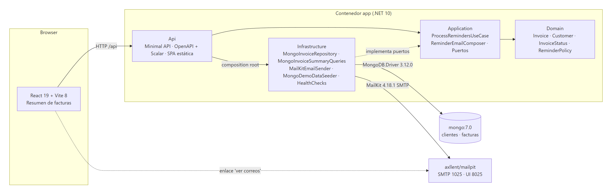
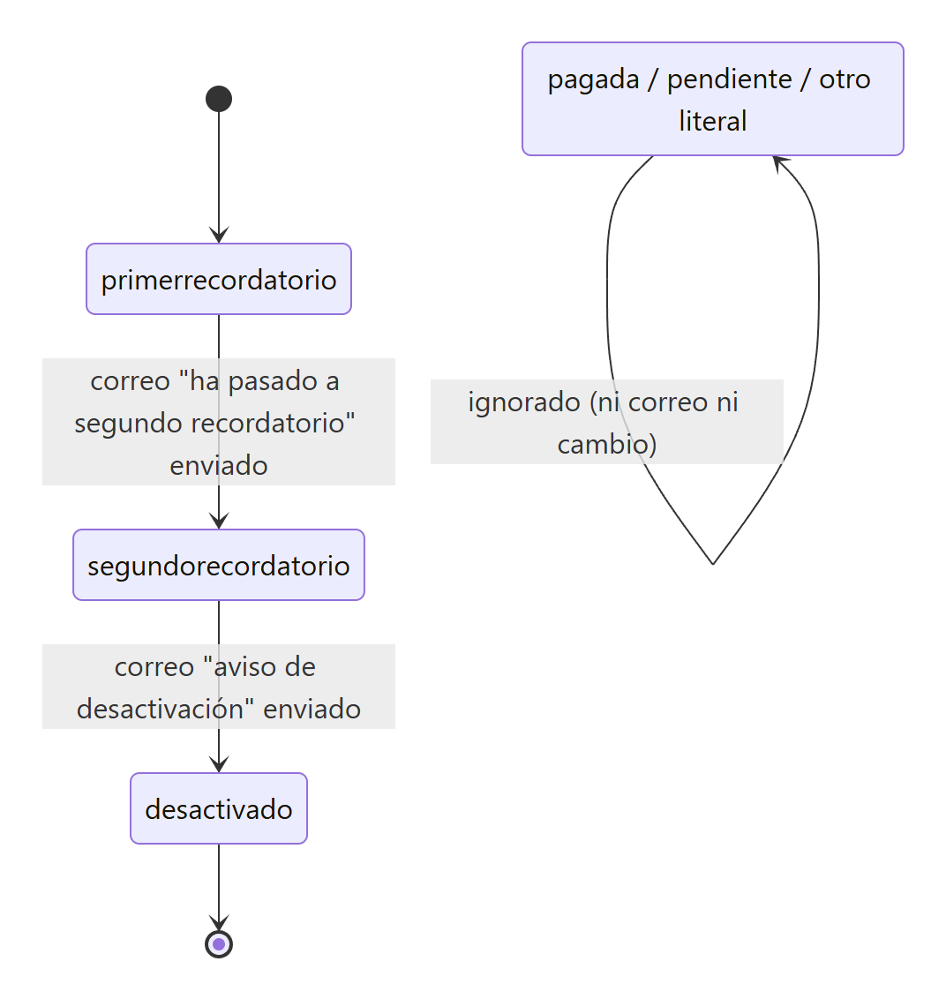
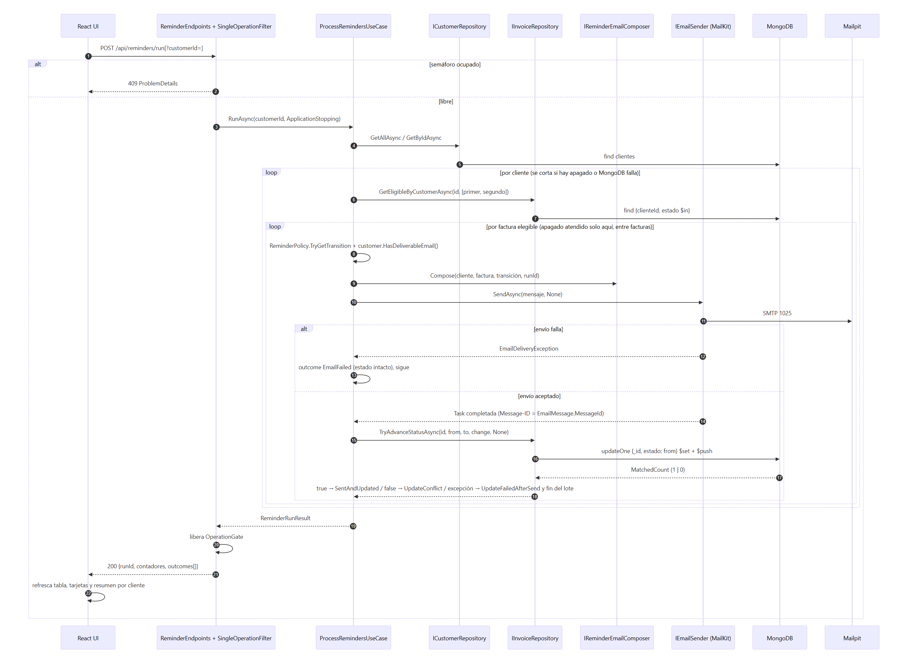
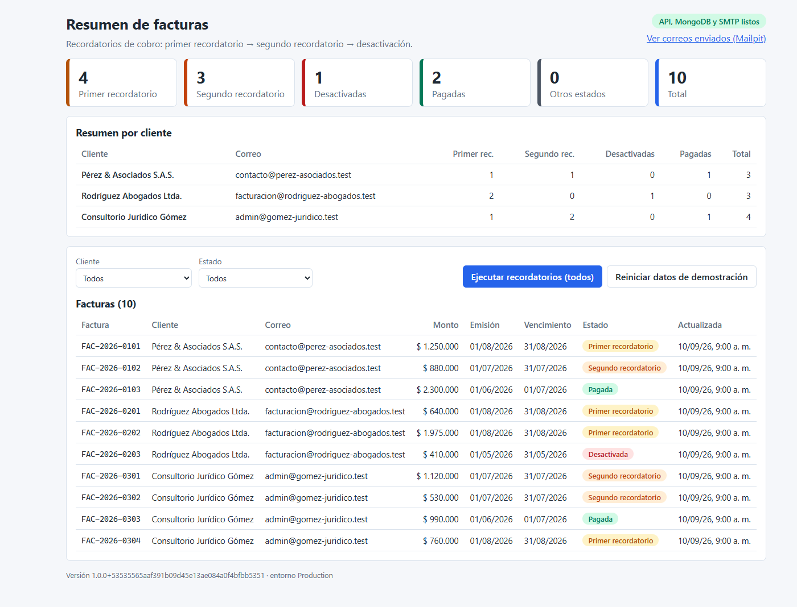
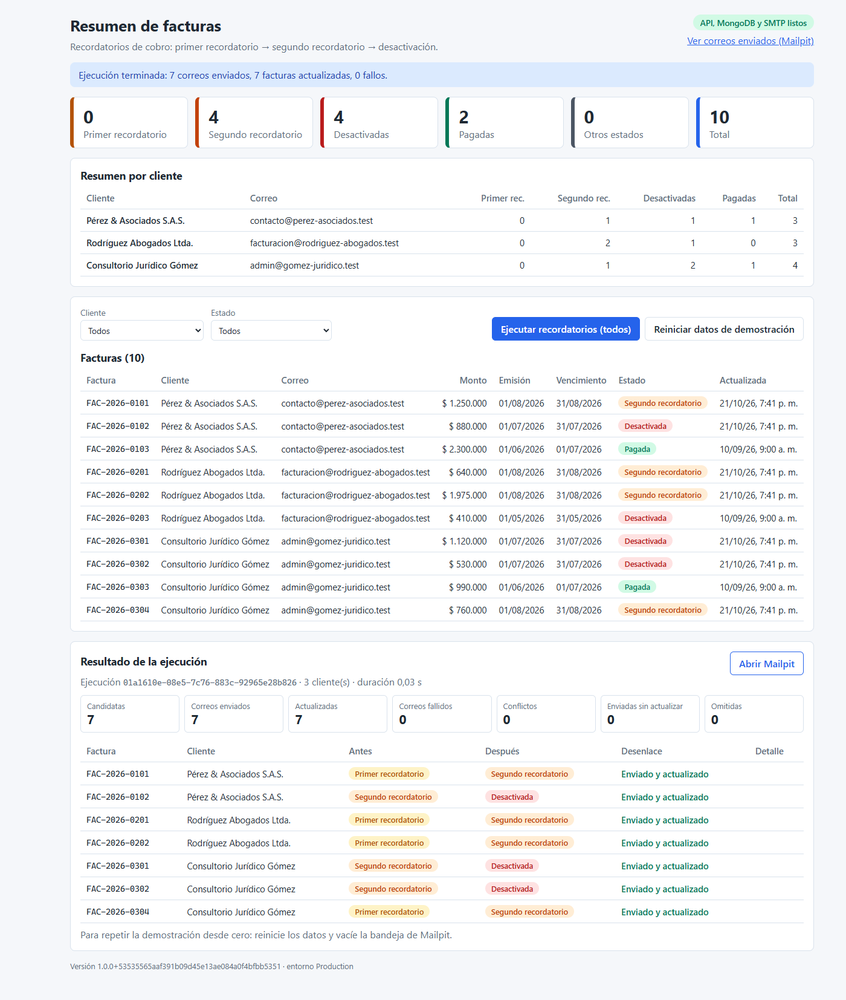
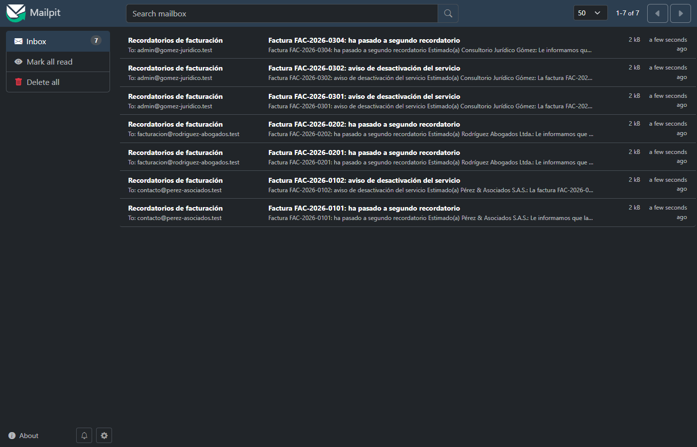
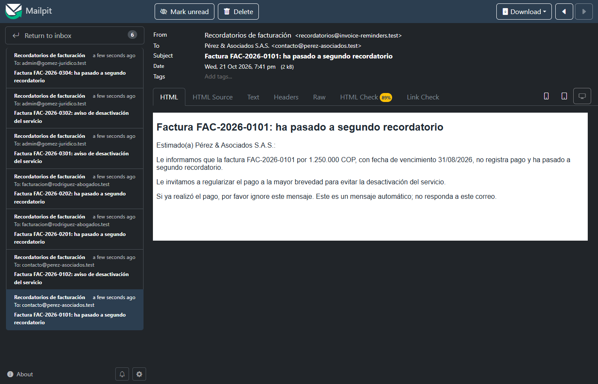
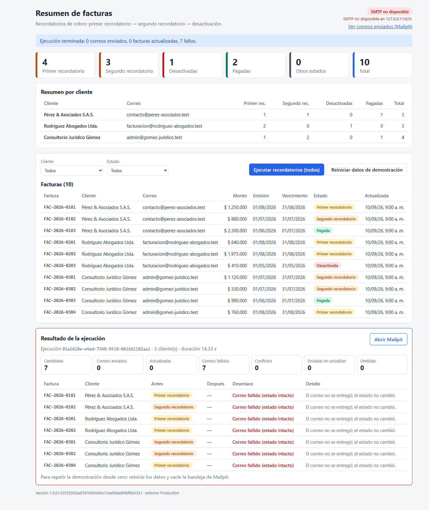
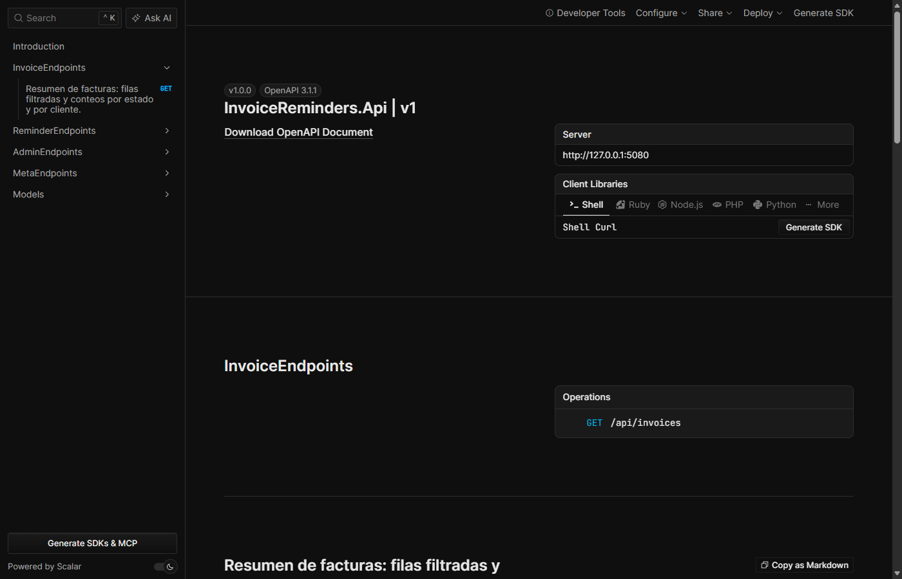

<!--
EXPORTACIÓN A PDF: el PDF se genera desde este archivo renderizándolo en Microsoft Edge sin ventana
(Markdown con marked y diagramas desde docs/img/), con Page.printToPDF. Antes de exportar no debe quedar
ningún marcador PENDIENTE, ninguna afirmación sin respaldo en el código del tag evaluado ni texto del enunciado.
-->

# Proceso de recordatorios de cobro sobre facturas — Documento de entrega

## 0. Encabezado

| | |
|---|---|
| Autor | Julian Contreras |
| Fecha de entrega | 21 de octubre de 2026 |
| Repositorio | https://github.com/JulianContreras02/invoice-reminders (público) |
| Tag evaluado | `v1.0.0` |
| Versiones | .NET 10 (LTS) · Node 22 (solo para desarrollo del frontend) · Docker Desktop · MongoDB 7.0 · Mailpit v1.31.6 |

Este documento explica qué se construyó, por qué, cómo se verificó y qué sigue. Los comandos, las variables de entorno y la solución de problemas están en el `README.md` del repositorio; aquí solo se incluyen los pasos para levantar y probar el sistema.

## 1. Resumen ejecutivo

Se construyó un proceso en .NET 10 y C# que, conectado a MongoDB, toma las facturas de cada cliente que están en primer o segundo recordatorio, envía al cliente el correo correspondiente y, únicamente después de que el envío fue aceptado, avanza el estado de la factura al siguiente escalón. El sistema funciona con tres clientes distintos con datos sembrados automáticamente y expone una interfaz React con el resumen de todas las facturas, conteos por estado y por cliente, y el botón que dispara el proceso. Todo se levanta con un solo comando (`docker compose up --build`) sin instalar .NET ni Node.

**Requisito → dónde está → cómo se verifica**

| Requisito | Dónde está en el código | Cómo se verifica |
|---|---|---|
| Conexión a MongoDB y lectura de facturas | `Infrastructure/Mongo/MongoContext.cs`, `MongoInvoiceRepository.cs`, `MongoStartupWaiter.cs` | La interfaz muestra 10 facturas al arrancar; con Mongo caído el log nombra el problema (CA-01, CA-02) |
| Identificar facturas en primer y segundo recordatorio | `Domain/Reminders/ReminderPolicy.cs`, `Domain/Invoices/InvoiceStatus.cs` | `ReminderPolicyTests` (`[Theory]`); `pagada`/`desactivado` nunca entran (CA-03, CA-09) |
| Correo según el estado | `Application/Email/SecondReminderTemplate.cs`, `DeactivationNoticeTemplate.cs`, `ReminderEmailComposer.cs` | `ReminderEmailComposerTests`; Mailpit muestra los dos asuntos (CA-04, CA-05) |
| Cambio de estado solo tras enviar | `Application/Reminders/ProcessRemindersUseCase.cs` (orden componer → enviar → actualizar) con CAS en `MongoInvoiceRepository.TryAdvanceStatusAsync` | `ProcessRemindersUseCaseTests` (`OperationJournal` registra `send` antes de `update`; con el envío fallido no hay `update`); escenario SMTP caído de la sección 7 (CA-06, CA-07, CA-08) |
| Tres clientes distintos | `Infrastructure/Seed/MongoDemoDataSeeder.cs` (`DemoData`) | `DemoDataTests`; resumen por cliente en la UI; 7 correos a 3 destinatarios (CA-11, CA-13) |
| Interfaz con resumen de facturas | `web/src/features/invoices/` (`InvoicesPage`, `InvoiceTable`, `SummaryCards`, `CustomerSummary`) | http://localhost:8080 antes y después de ejecutar (CA-12) |

**Criterio de evaluación → evidencia**

| Criterio | Evidencia en el repositorio |
|---|---|
| Clean Code y SOLID | `ReminderPolicy` como única tabla de transiciones; `InvoiceStatus` como único lugar con los literales; `ProcessRemindersUseCase` solo orquesta (6 dependencias); puertos de 1-2 métodos; referencias de `.csproj` hacia Domain; analizadores (`AnalysisLevel latest`, `EnforceCodeStyleInBuild`) y warnings como errores con `ContinuousIntegrationBuild=true`; `.editorconfig` |
| Documentación, planteamiento y arquitectura | `README.md`, `docs/ARQUITECTURA.md` (Mermaid: componentes, estados, secuencia, modelo de datos), `docs/adr/0001…0010`, `docs/VERIFICACION.md`, este documento |
| Pruebas unitarias | `tests/InvoiceReminders.UnitTests` (`xunit.v3.mtp-off`, la variante oficial de xunit.v3 sin Microsoft Testing Platform; 48 métodos / 62 casos, < 3 s, sin servicios externos); dobles escritos a mano en `Fakes/` (repositorio en memoria con compare-and-set, `OperationJournal` para el orden envío → actualización); `dotnet test` |
| Inyección de dependencias | `Application/DependencyInjection.cs`, `Infrastructure/DependencyInjection.cs`, `Program.cs` de menos de 70 líneas, `IOptions<T>` validadas con `ValidateOnStart()`, `DependencyInjectionTests` con `ValidateOnBuild`; tabla abstracción → implementación → lifetime con razón en `docs/ARQUITECTURA.md` |
| Frontend (React) | `web/` con Vite 8 + React 19 + TypeScript strict; compilado dentro de la imagen y servido desde `wwwroot` en el mismo origen |
| Desarrollo en Visual Studio | `InvoiceReminders.slnx`, perfiles `http`/`https` en `launchSettings.json` (abren `/scalar`), `InvoiceReminders.Api.http`, Explorador de pruebas con xunit.v3 (`xunit.v3.mtp-off`), depuración local con `docker compose up -d mongo mailpit` |

## 2. Alcance y supuestos

- **Origen de los datos:** las facturas son documentos en MongoDB creados por el candidato con datos de prueba; no hay ingesta de archivos. El punto de extensión es `IInvoiceRepository`: una futura ingesta escribiría en la misma colección sin tocar el proceso.
- **"Cliente":** la entidad deudora dueña de las facturas (un registro en la colección `clientes`, referenciado desde `facturas`), con un correo de contacto único. "Tres clientes" son tres registros de cliente con sus facturas en una misma base.
- **Un correo por factura** (1 correo = 1 transición = 1 entrada de historial). Consolidar por cliente queda como mejora.
- **Disparo manual** (`POST /api/reminders/run` y botón en la UI); nunca al arrancar; sin temporizador. Puede ejecutarse para todos los clientes o para uno.
- **Un paso por ejecución**, sin ventanas de tiempo (el proceso no las define). Estados distintos de `primerrecordatorio` y `segundorecordatorio` se ignoran (ni correo ni cambio) y se muestran en la UI.
- **Fallos:** si falla el correo, el estado no cambia, se registra y el lote continúa con la siguiente factura. Si el correo salió y la actualización falla, queda como inconsistencia visible y rastreable por `Message-ID`, y el lote se detiene para no enviar correos que no podrían registrarse; lo mismo si MongoDB falla al leer las facturas de un cliente. Los mensajes de error que ve el usuario son genéricos, sin datos personales; el detalle técnico queda en el log.
- **"Desactivado"** solo cambia el estado de la factura; el correo anuncia la desactivación del servicio como hecho futuro.
- **SMTP real** tras una interfaz; en la demo apunta a Mailpit (un simple log no cumpliría "enviar un correo"); la semilla usa el dominio reservado `.test`. **Sin autenticación** en la demo (solo demo local; puertos publicados únicamente en loopback).

## 3. Arquitectura

Monolito modular en .NET 10 con cuatro proyectos de producto (Domain, Application, Infrastructure, Api), frontend React compilado dentro de la imagen de la API y `docker compose` con tres contenedores (app, mongo, mailpit). Todas las dependencias apuntan al dominio y se hacen cumplir con las referencias de los `.csproj`; `dotnet list … --include-transitive` permite comprobar que Application no arrastra paquetes de infraestructura.



| Proyecto | Referencia a | Contiene |
|---|---|---|
| Domain | nada | `Customer`, `Invoice`, `InvoiceStatus`, `ReminderPolicy` (tabla de transiciones) |
| Application | Domain | puertos (`IInvoiceRepository`, `IInvoiceSummaryQueries`, `ICustomerRepository`, `IEmailSender`), `ProcessRemindersUseCase`, compositor y plantillas de correo, DTOs de resumen |
| Infrastructure | Application | repositorios Mongo con CAS, `MailKitEmailSender`, semilla, health checks, options validadas, arranque (`IInfrastructureInitializer`: esperar Mongo → índices → semilla) |
| Api | Application + Infrastructure | composición, endpoints Minimal API, `LinksOptions`, `OperationGate` + `SingleOperationFilter` (409), traducción de errores, SPA |

**Estados de la factura** (misma tabla que `ReminderPolicy.Transitions`):



`primerrecordatorio` → `segundorecordatorio` (correo "ha pasado a segundo recordatorio") → `desactivado` (correo "aviso de desactivación"). `pagada`, `pendiente` y cualquier otro literal se ignoran.

**Secuencia del proceso:**



Por cliente y por factura elegible: `ReminderPolicy.TryGetTransition` → validación del correo del cliente (`Customer.HasDeliverableEmail()`) → `Compose` → `SendAsync` (si lanza `EmailDeliveryException`: desenlace `EmailFailed`, estado intacto, sigue la siguiente factura) → `TryAdvanceStatusAsync` con filtro `{_id, estado: anterior}` (`UpdateOneAsync` con `$set` + `$push` al historial, éxito si `MatchedCount == 1`; `false` → `UpdateConflict`; excepción → `UpdateFailedAfterSend` y el lote se detiene). El lote corre con el token de apagado de la aplicación, no con el de la petición; el apagado se atiende solo entre facturas y entre clientes, porque cada factura es una unidad de trabajo cuyo envío y actualización no se interrumpen. Cómo terminó la ejecución queda en `RunCompletion` (`Completed`, `Cancelled` o `StoppedPersistenceUnavailable`). Ejecuciones simultáneas se rechazan con `409`.

**Modelo de datos e índices.** Base `invoice_reminders`; colecciones `clientes` (`_id`, `nombre`, `email`, `creadoEn`) y `facturas` (`_id` = número de factura, p. ej. `FAC-2026-0102`; `clienteId`, `monto` como `Decimal128`, `moneda`, `fechaEmision`, `fechaVencimiento`, `estado`, `historialEstados[]`, `actualizadoEn`). Índices: `facturas {clienteId:1, estado:1}` y `clientes {email:1} unique`, creados de forma idempotente al arrancar. Campos en español porque `estado` es el contrato visible; código en inglés con la traducción en `DocumentMappers`. **Contrato de la API:** anexo C; JSON camelCase, errores `application/problem+json` (RFC 9457) con `traceId`, documento OpenAPI en `/openapi/v1.json` y documentación interactiva (Scalar) en `/scalar`.

## 4. Decisiones y alternativas

Cada ADR (contexto, decisión, alternativas, consecuencias) está en `docs/adr/`; índice en `docs/DECISIONES.md`.

| # | Decisión | Alternativa descartada | Razón principal |
|---|---|---|---|
| [0001](adr/0001-version-dotnet-y-visual-studio.md) | .NET 10 LTS con Visual Studio 2026 (18.x) | .NET 8 + VS 2022 | .NET 8 y 9 pierden soporte el 10-nov-2026; compose no depende del VS del revisor; plan B `net8.0` es una línea |
| [0002](adr/0002-minimal-api.md) | Minimal API con `MapGroup("/api")`, `TypedResults`, OpenAPI nativo y Scalar | Controllers MVC | Menos ceremonia para 6 endpoints; filtros de endpoint y ProblemDetails integrados |
| [0003](adr/0003-disparo-manual-y-un-correo-por-factura.md) | Disparo manual; un correo por factura; nunca al arrancar | `BackgroundService` programado; correo consolidado | El revisor ve antes/después con semilla intacta; trazabilidad 1 correo = 1 transición |
| [0004](adr/0004-orden-envio-actualizacion-cas.md) | Enviar → actualizar con CAS (`UpdateOneAsync` filtrado por estado anterior) + `$push`; sin reintento, sin transacciones | Actualizar primero; transacciones; `BoundedRetry`; outbox | Respeta el orden literal; idempotente ante carreras; las transacciones exigirían replica set y no evitan el problema real (el correo ya salió) |
| [0005](adr/0005-contrato-de-datos-e-idioma.md) | Código en inglés; literales, campos y colecciones Mongo en español; `_id` = número de factura | Todo en español; todo en inglés; `ObjectId` + `numero` único | El contrato visible coincide con lo que se consulta en Mongo; `_id` legible simplifica semilla, UI y Mailpit |
| [0006](adr/0006-frontend-react-servido-desde-la-api.md) | React 19 + Vite 8 + TypeScript strict, compilado dentro de la imagen de la API | Angular; contenedor nginx aparte | Una pantalla no necesita módulos ni router; un contenedor, un origen, sin CORS |
| [0007](adr/0007-mailkit-y-mailpit.md) | MailKit + Mailpit v1.31.6; sin emisor simulado; plantillas por interpolación con `HtmlEncode` | MailHog; `System.Net.Mail`; `LoggingEmailSender`; motor de plantillas | Mailpit mantenido (release semanal) con API REST; un emisor que simula éxito permitiría avanzar estados sin correo |
| [0008](adr/0008-estrategia-de-pruebas.md) | Un proyecto de pruebas unitarias con `xunit.v3.mtp-off` 4.0.2 (xunit.v3 sin Microsoft Testing Platform) y `dotnet test` clásico (VSTest); dobles escritos a mano; sin Testcontainers; warnings como errores solo con `ContinuousIntegrationBuild=true` | xunit 2.9.3; NSubstitute; Microsoft.Testing.Platform; Testcontainers y suite de contrato | v2 deprecado en NuGet; proporcionalidad para una prueba técnica, menos dependencias y el doble del repositorio documenta el contrato del CAS |
| [0009](adr/0009-despliegue-compose-y-semilla.md) | `docker compose` con app + mongo + mailpit, loopback, sin `restart`; semilla en la aplicación, opt-in; CI en GitHub Actions con compilación estricta, pruebas, regla de dependencias y prueba de humo del compose | Scripts `docker-entrypoint-initdb.d`; `restart: unless-stopped`; puertos abiertos | Mismo código de semilla en compose, F5, reinicio y pruebas; un error de configuración se ve en el log, no como bucle |
| [0010](adr/0010-repositorio-publico-y-confidencialidad.md) | Repositorio público; confidencialidad por contenido: nombre neutral, sin el texto de la prueba ni la empresa evaluadora | Privado con invitación (decisión inicial) | El contenido ya cumple la confidencialidad; el revisor accede y ve el CI sin pasos previos |

## 5. Calidad y pruebas

- **Unitarias** (`tests/InvoiceReminders.UnitTests`, 48 métodos / 62 casos): política de transiciones como `[Theory]` y literales de `InvoiceStatus`, validación del correo del cliente (`CustomerTests`), compositor (destinatario, asuntos, `es-CO`, cabeceras, `Message-ID`, nombre con `&`, plantilla faltante), caso de uso (orden enviar → actualizar, fallo de envío sin cambio de estado, conflicto CAS, fallo de actualización tras el envío y corte del lote, corte si falla la lectura de un cliente, cliente sin correo válido, apagado entre facturas y antes del siguiente cliente, ningún envío ni actualización con un token cancelable, tres clientes sin cruces, historial con `runId` y `Message-ID`, invariantes de contadores), semilla (7 → 4 → 0), grafo de DI, mapeo a documentos de MongoDB (`DocumentMappersTests`: ida y vuelta, fechas UTC, estado ausente) y la regla `IsDeliveryFailure` de `MailKitEmailSender`. Dobles escritos a mano en `Fakes/` (`InMemoryInvoiceRepository` con semántica compare-and-set y fallos de lectura o escritura simulables, `InMemoryCustomerRepository`, `RecordingEmailSender`, `OperationJournal`, `FixedTimeProvider`). Sin Docker ni red; < 3 s.
- **Integración:** no incluida. Las pruebas contra MongoDB real con Testcontainers quedan como evolución (sección 8).
- **Manual / extremo a extremo:** guía de la sección 7 y `docs/VERIFICACION.md` con capturas. De `MailKitEmailSender` solo se prueba por unidad la regla que decide qué es un fallo de entrega; el envío real (sería probar MailKit) se valida contra Mailpit.
- **Frontend:** sin pruebas de componentes ni ESLint; la verificación es la compilación estricta de TypeScript (`npm run build` = `tsc && vite build`, ejecutada en el build de Docker).

```bash
dotnet test
```

Es el `dotnet test` clásico (VSTest), gracias a `xunit.v3.mtp-off` (variante oficial de xunit.v3 que desactiva Microsoft Testing Platform), desde la raíz de la solución (`InvoiceReminders.slnx`); también `dotnet test tests/InvoiceReminders.UnitTests`.

Resultado: 62 casos (48 métodos) en verde en unos 2 s, sin Docker ni red; compilación Release con `-p:ContinuousIntegrationBuild=true` sin advertencias. Estándares: `Directory.Build.props` con `AnalysisLevel latest` y `EnforceCodeStyleInBuild`; `TreatWarningsAsErrors` solo con `ContinuousIntegrationBuild=true`; `.editorconfig`; async de punta a punta con `CancellationToken`; sin `catch` vacíos.

CI: `.github/workflows/ci.yml` en GitHub Actions con tres trabajos. `backend` compila con advertencias como errores, ejecuta las pruebas y verifica que Application no arrastra `MongoDB`, `MailKit`, `MimeKit` ni `Microsoft.AspNetCore`. `frontend` ejecuta `npm ci` y `npm run build`. `compose-smoke` descarga las imágenes y construye con reintentos, levanta el docker compose real y ejecuta `.github/scripts/compose-smoke.sh`, que reproduce la secuencia de 7, 4 y 0 correos contra la API y la bandeja de Mailpit. Primera ejecución en verde, con los tres trabajos: https://github.com/JulianContreras02/invoice-reminders/actions/runs/39697939578

## 6. Progreso

| Fase | Contenido | Estado |
|---|---|---|
| 1. Planeación | Lectura de requisitos y supuestos, 10 decisiones confirmadas como ADR, esquema y semilla, plantillas de correo, estructura de la solución | Completa |
| 2. Desarrollo | Domain → Application + pruebas unitarias → Infrastructure (MongoDB, MailKit, semilla, salud) → Api → Frontend → Docker → CI | Completa |
| 3. Pruebas | 62 pruebas unitarias en verde; compilación estricta sin advertencias; CI en verde en GitHub (backend, frontend y docker compose real); ensayo con el docker compose final (MongoDB 7.0 y Mailpit 1.31.6) desde un clon limpio: secuencia de 7, 4 y 0 correos, contenido y cabeceras de los correos, reinicio de datos y escenario SMTP caído (7 `EmailFailed`, estados intactos, recuperación al volver Mailpit) | Completa |
| 4. Entrega | README, ARQUITECTURA, ADR definitivos, VERIFICACION con capturas reales, este documento en PDF, tag `v1.0.0` | Completa |

- Estado por requisito: los criterios de aceptación CA-01 a CA-17 están en `docs/VERIFICACION.md`. 16 de 17 están verificados: los de lógica (CA-02 a CA-11, CA-15, CA-16) con pruebas unitarias y con el ensayo contra MongoDB y Mailpit reales; los de despliegue e interfaz (CA-01, CA-12, CA-13) con el trabajo `compose-smoke` del CI y las capturas; CA-01 también en su camino negativo (sin MongoDB, 15 reintentos y salida con código 1 en unos 105 s). CA-14 compila y se prueba con el SDK 10.0.402 y en el CI; abrir la solución en Visual Studio 2026 es la verificación que falta.
- Capas opcionales: se incluyó CI con prueba de humo del compose. No se incluyeron integración con Testcontainers, `docker-compose.dcproj`, pruebas de componentes React ni el endpoint de detalle con historial; quedan en la sección 8.
- Problemas encontrados y cómo se resolvieron:
  - **Runner de pruebas.** xunit.v3 4.0 usa Microsoft Testing Platform por defecto, y con el SDK 10 eso cambia la sintaxis de `dotnet test` y su integración con VSTest. Se eligió `xunit.v3.mtp-off`, la variante oficial que deja el `dotnet test` clásico y el Explorador de pruebas sin configuración extra.
  - **Codificación HTML de los correos.** `WebUtility.HtmlEncode` también codifica las letras acentuadas (`é` → `&#233;`). Una prueba que buscaba el nombre literal en el HTML habría fallado; ahora verifica solo la codificación del `&`, que es lo que protege el correo.
  - **Restauración de NuGet dependiente de la máquina.** En un equipo sin orígenes configurados la restauración fallaba sin mensaje. Se añadió `nuget.config` con nuget.org explícito, para que el build sea igual en cualquier máquina.
  - **Dependencia transitiva con avisos de seguridad.** MimeKit 4.18.1 trae `System.Security.Cryptography.Pkcs` 10.0.0 (GHSA-2fmv-rv2c-59x7, GHSA-846f-f764-76mx). Se fijó a 10.0.13 con Central Package Management en lugar de silenciar el aviso.
  - **Comentario XML inválido.** Un comentario en `Directory.Build.props` contenía dos guiones seguidos y MSBuild no podía cargar el archivo; se reescribió.
  - **Arranque ordenado con Mailpit.** Se comprobó en el Dockerfile oficial de Mailpit que su imagen declara un `HEALTHCHECK`, y la aplicación espera con `service_healthy` para que el indicador de salud arranque en verde.
  - **MongoDB 8 y los kernels de Linux recientes.** Tres ejecuciones del CI fallaron al levantar el compose en commits que solo cambiaban documentación. Las anotaciones del trabajo mostraron que el contenedor de MongoDB terminaba con código 1 al arrancar. La causa es una verificación de MongoDB 8: se niega a correr en kernels Linux 6.19 o superiores (SERVER-121912), y GitHub está desplegando máquinas con un kernel así por oleadas, por eso fallaba solo a veces. Como Docker usa el kernel del equipo anfitrión, al revisor le podía pasar lo mismo. Se cambió a `mongo:7.0`, que no tiene esa restricción y tiene soporte hasta 2027. Además, el CI descarga y construye con reintentos y deja las últimas líneas de cada contenedor como anotación visible sin abrir el log.
  - **Revisión interna del proceso.** Se detectó que un apagado durante un envío perdía el resultado del lote, que un fallo al cerrar la conexión SMTP podía duplicar correos y que con MongoDB caído el lote seguía enviando. Se corrigió con `RunCompletion`, la factura como unidad de trabajo (envío y actualización sin token cancelable; el correo cuenta como entregado en cuanto el servidor lo acepta) y el corte del lote con `StoppedPersistenceUnavailable`, con pruebas para cada caso.

## 7. Guía de verificación

Requisito previo único: Docker Desktop. No hace falta .NET ni Node.

**Paso 1 — Levantar.**

```bash
git clone https://github.com/JulianContreras02/invoice-reminders.git && cd invoice-reminders
docker compose up --build
```

Interfaz: http://localhost:8080 · API docs: http://localhost:8080/scalar · Salud: http://localhost:8080/health/ready · Correos: http://localhost:8025. En la interfaz: 10 facturas, tarjetas con 4 en primer recordatorio, 3 en segundo, 1 desactivada y 2 pagadas, y el resumen por cliente con los tres clientes (nombre, email y facturas por estado).

**Paso 2 — Ejecutar.** Pulse **Ejecutar recordatorios (todos)**. En Mailpit: 7 correos, 3 destinatarios, 2 asuntos ("ha pasado a segundo recordatorio" ×4 y "aviso de desactivación del servicio" ×3). En la tabla: 0 / 4 / 4 / 2. Repita: 4 correos y 0 / 0 / 8 / 2. Repita de nuevo: 0 correos; nada cambia.

**Paso 3 — Escenario de SMTP caído (el estado no cambia si el correo no sale).**

```bash
docker compose stop mailpit
```

El chip de salud pasa a "SMTP no disponible". Ejecute: el resultado muestra las candidatas como "Correo fallido (estado intacto)" (`EmailFailed`) y la tabla conserva los estados. Luego:

```bash
docker compose start mailpit
```

Ejecute otra vez: las mismas facturas se procesan y los correos aparecen en Mailpit.

**Repetir la demo:** botón **Reiniciar datos de demostración** **y** vaciar Mailpit (*Delete all* en su interfaz o `DELETE http://localhost:8025/api/v1/messages`); si no se vacía, los correos se acumulan (7 + 4 + 7).

**Solución de problemas (detalle en el README):** puerto ocupado → `.env` con `APP_PORT`/`MAILPIT_PORT`/`SMTP_PORT`/`MONGO_PORT`; Docker sin memoria o WSL2 → asignar memoria y reiniciar Docker Desktop; proxy corporativo → configurar proxy en Docker Desktop para npm y NuGet; `app` en `Exited` → `docker compose logs app`, la última línea nombra la causa; CPU x86 sin AVX → MongoDB ≥ 5.0 no arranca; no hay tag alternativo, usar otra máquina o VM con AVX.

## 8. Pasos a seguir y evolución

Piezas de ingeniería consideradas y no implementadas: pruebas de integración con Testcontainers contra MongoDB real (con una suite de contrato compartida por el repositorio en memoria y el de Mongo), `docker-compose.dcproj` para depurar con F5 dentro de Docker Compose en Visual Studio, pruebas de componentes React (Vitest + Testing Library) y ESLint y el detalle de factura con historial (`GET /api/invoices/{id}`).

Extensiones naturales del mismo caso de uso, no incluidas a propósito: job programado (`BackgroundService` deshabilitado por defecto), consolidación de correos por cliente, ventanas de tiempo entre recordatorios, outbox o colección de auditoría de envíos (haría el duplicado detectable antes, no imposible), lease distribuido en Mongo con TTL para varias instancias, autenticación y autorización, paginación y observabilidad con OpenTelemetry.

**Lo que no se hizo a propósito:** OCR, LLM o ingesta de archivos (no está pedido; añadiría claves, costo y no determinismo; el punto de extensión queda en `IInvoiceRepository`); microservicios, API Gateway, Kubernetes; colas, Event Sourcing; MediatR, CQRS formal, AutoMapper, repositorio genérico, UnitOfWork, Polly; transacciones multi-documento (exigirían replica set y no evitan que el correo ya salió); emisor de correo simulado; CORS; target MSBuild que ejecute npm; `docker-compose.override.yml` generado por Visual Studio; acoplar "Reiniciar datos" a la API de Mailpit; imágenes `alpine` de .NET (rompen el formato `es-CO`); prometer un tag de Mongo sin AVX.

## Anexos

### A. Estructura de carpetas

`InvoiceReminders.slnx`, `src/InvoiceReminders.{Domain,Application,Infrastructure,Api}`, `tests/InvoiceReminders.UnitTests`, `web/` (React), `docs/` (ARQUITECTURA, DECISIONES, adr/, VERIFICACION, ENTREGA), `docker-compose.yml`, `.env.example`, `global.json`, `Directory.Build.props`, `Directory.Packages.props`. Árbol completo en el README.

### B. Variables de entorno

| Variable | Valor en compose | Variable | Valor en compose |
|---|---|---|---|
| `Mongo__ConnectionString` | `mongodb://mongo:27017` | `Smtp__FromName` | `Recordatorios de facturación` |
| `Mongo__Database` | `invoice_reminders` | `Smtp__Username` / `Smtp__Password` | vacíos (opcionales, van juntos) |
| `Smtp__Host` | `mailpit` | `Seed__Mode` | `IfEmpty` (por defecto en código `Never`) |
| `Smtp__Port` | `1025` | `Seed__AllowReset` | `true` (por defecto en código `false`) |
| `Smtp__Security` | `None` (`None`, `StartTls`, `SslOnConnect`, `Auto`) | `Links__MailpitUrl` | `http://localhost:8025` |
| `Smtp__FromAddress` | `recordatorios@invoice-reminders.test` | `APP_PORT` / `MAILPIT_PORT` / `SMTP_PORT` / `MONGO_PORT` (`.env`) | `8080` / `8025` / `1025` / `27017` |

Para un SMTP real solo cambian variables: `Smtp__Port=587` + `Smtp__Security=StartTls`, o `Smtp__Port=465` + `Smtp__Security=SslOnConnect`, más usuario y contraseña. Nunca se versionan credenciales.

### C. Endpoints

| Método y ruta | Respuesta |
|---|---|
| `GET /api/invoices?customerId=&status=` | `InvoiceSummaryDto { invoices[], countsByStatus{}, customers[], total }` (el resumen por cliente sale de `customers[]`) |
| `POST /api/reminders/run[?customerId=]` | 200 `ReminderRunResult` · 404 cliente · 409 operación en curso |
| `POST /api/admin/seed/reset` | 200 `SeedResult` · 403 si `Seed:AllowReset=false` · 409 en curso |
| `GET /api/meta` | `{ version, environment, mailpitUrl, allowReset }` |
| `GET /health/live` · `GET /health/ready` | 200 · 200/503 con `{ status, checks: [{ name: "mongo" \| "smtp", status, description }] }` |
| `GET /openapi/v1.json` · `GET /scalar` | Documento OpenAPI · documentación interactiva |
| Otra ruta bajo `/api` | 404 |
| `GET /` y rutas no-API | `index.html` de React |

### D. Capturas

Tomadas con la aplicación funcionando contra MongoDB y Mailpit reales.













Pruebas unitarias con el SDK 10.0.402: 62 de 62 en verde en unos 3 s.

### E. Plantillas de correo

Remitente: `Recordatorios de facturación <recordatorios@invoice-reminders.test>`. Un correo por factura, multipart texto + HTML (`ReminderEmailLayout` genera ambos desde los mismos párrafos y codifica el HTML con `WebUtility.HtmlEncode`), monto formateado en `es-CO`, fecha `dd/MM/yyyy`, `Message-ID` determinista `{numeroFactura}.{estadoAnterior}.{runId sin guiones}@invoice-reminders.test` (guardado sin corchetes angulares en el historial) y cabeceras `X-Invoice-Id`, `X-Reminder-Kind`, `X-Reminder-Run-Id`.

**A — Segundo recordatorio** (factura encontrada en `primerrecordatorio`). Asunto: `Factura {numero}: ha pasado a segundo recordatorio`. Cuerpo: "Estimado(a) {nombreCliente}: Le informamos que la factura {numero} por {monto} {moneda}, con fecha de vencimiento {fechaVencimiento}, no registra pago y ha pasado a segundo recordatorio. Le invitamos a regularizar el pago a la mayor brevedad para evitar la desactivación del servicio. Si ya realizó el pago, por favor ignore este mensaje. Este es un mensaje automático; no responda a este correo."

**B — Aviso de desactivación** (factura encontrada en `segundorecordatorio`). Asunto: `Factura {numero}: aviso de desactivación del servicio`. Cuerpo: "Estimado(a) {nombreCliente}: La factura {numero} por {monto} {moneda}, vencida el {fechaVencimiento}, se encontraba en segundo recordatorio y continúa sin pago, por lo que el servicio asociado va a ser desactivado. Para evitarlo, realice el pago y comuníquese con nosotros. Si ya realizó el pago, por favor ignore este mensaje. Este es un mensaje automático; no responda a este correo."
